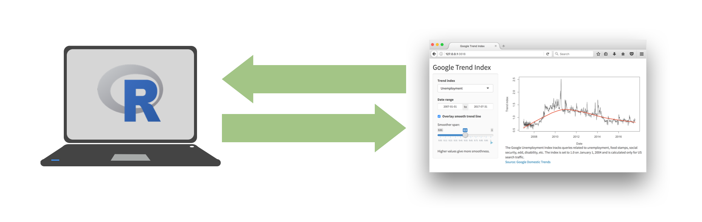

```{r setup, include=FALSE}
library(countdown)
library(tidyverse)
```

## The plan for the next three days

We will build **one** app, a little at a time:

| Day | What we add | App version |
|:----|:------------|:------------|
| Fri (today) | an input, an output, a second input, a filter | `v0` $\to$ `v2` |
| Mon | reactive expressions; put it online | `v3` |
| Wed | layout, theme, project structure | `v4` |

. . .

The data: the *Ask a Manager* salary survey (the same one as our <a href="https://stat220-f26.github.io/portfolio/portfolio-3.html">portfolio project</a> examples).

## Demo

```{r}
#| echo: false
#| fig-align: center
knitr::include_app("https://gallery.shinyapps.io/goog-trend-index/", height = "600px")
```

## Shiny: the high level view

Every Shiny app has a webpage that the user visits, and behind this webpage there is a computer that serves it by running R.

```{r echo = FALSE, out.width = "85%"}

```

. . .

Running locally, that computer is yours. Deployed, it is a web server. (We'll deploy on Monday.)

## Every app has three parts

```{r eval = FALSE}
library(shiny)

ui <- fluidPage(
  # what the user SEES: inputs and outputs
)

server <- function(input, output, session) {
  # what R DOES: build the outputs from the inputs
}

shinyApp(ui = ui, server = server)
```

. . .

- `ui` is a description of a web page (it is just R code that makes HTML)
- `server` is a *function* that R runs for each person using the app

## Let's read an app: `v0-hist`

::: columns
::: {.column width="55%"}
```{r eval = FALSE}
ui <- fluidPage(
  titlePanel("Ask a Manager"),
  sliderInput("bins", 
    label = "Number of bins", 
    min = 5, max = 50, value = 20),
  plotOutput("salary_hist")
)

server <- function(input, output, session) {
  output$salary_hist <- renderPlot({
    ggplot(manager_survey, 
           aes(x = annual_salary)) +
      geom_histogram(bins = input$bins, 
                     color = "white")
  })
}
```
:::

::: {.column width="45%"}
- One **input**: `sliderInput("bins", ...)`
- One **output**: `plotOutput("salary_hist")`
- The server connects them: `output$salary_hist` is built with `renderPlot()` and uses `input$bins`
:::
:::

## Your turn 1: run `v0-hist`

::: {.task .nonincremental}
Open [`v0-hist/app.R`](https://stat220-f26.github.io/files/shiny-apps/v0-hist/app.R) and click **Run App**.

1. What happens when you move the slider?
2. Find the input's **ID**. Where else does that name show up?
3. Find the output's **ID**. Where else does that name show up?
4. Change the slider so it starts at 10 bins, and can go up to 100.
:::

```{r}
#| echo: false
countdown(5)
```

## The one rule

::: {.nonincremental}
- Every input has an **ID**: `sliderInput("bins", ...)`. In the server you get its value with `input$bins`
- Every output has an **ID**: `plotOutput("salary_hist")`. In the server you build it with `output$salary_hist <- render...({ })`
- Each output *type* has a matching render function:
:::

| In the UI | In the server |
|:----------|:--------------|
| `plotOutput("id")` | `output$id <- renderPlot({ })` |
| `textOutput("id")` | `output$id <- renderText({ })` |
| `tableOutput("id")` | `output$id <- renderTable({ })` |
| `DT::dataTableOutput("id")` | `output$id <- DT::renderDataTable({ })` |

. . .

IDs must be unique, and `input$...` can only be used *inside* a `render` function (or, on Monday, a `reactive`).

## Adding an input: `v1-xcol`

```{r eval = FALSE}
ui <- fluidPage(
  titlePanel("Ask a Manager"),
  sliderInput("bins", label = "Number of bins", min = 5, max = 50, value = 20),
  selectInput("xcol", label = "Compare salaries by", 
              choices = c("age", "education", "gender")),
  plotOutput("salary_hist"),
  plotOutput("salary_jitter")      # a second output
)
```

```{r eval = FALSE}
output$salary_jitter <- renderPlot({
  ggplot(manager_survey, aes(x = .data[[input$xcol]], y = annual_salary)) +
    geom_jitter(alpha = 0.3, height = 0, width = 0.2)
})
```

. . .

`input$xcol` is a *string* (`"age"`), not a column. `.data[[input$xcol]]` tells `aes()` to look up the column with that name.

## Your turn 2: `v1-xcol`

::: {.task .nonincremental}
Open [`v1-xcol/app.R`](https://stat220-f26.github.io/files/shiny-apps/v1-xcol/app.R) and run it.

1. Which input changes which output?
2. Add `"industry"` as a fourth choice for `xcol`. Does it work? What do you think of the plot?
3. Add a `checkboxInput("minimal", "White background", value = FALSE)` that switches the **jitter plot** to `theme_minimal()` (hint: `if (input$minimal) { plot <- plot + theme_minimal() }`)
:::

```{r}
#| echo: false
countdown(8)
```

## Adding a filter: `v2-filter`

```{r eval = FALSE}
checkboxGroupInput("industry", label = "Industries",
  choices = industry_choices,
  selected = c("Computing or Tech", "Nonprofits", "Health care"))
```

```{r eval = FALSE}
output$salary_hist <- renderPlot({
  manager_survey |>
    filter(industry %in% input$industry) |>      # <- here...
    ggplot(aes(x = annual_salary)) + ...
})

output$salary_jitter <- renderPlot({
  manager_survey |>
    filter(industry %in% input$industry) |>      # <- ...and here
    ggplot(aes(x = .data[[input$xcol]], y = annual_salary, color = industry)) + ...
})
```

## Your turn 3: `v2-filter`

::: {.task .nonincremental}
Open [`v2-filter/app.R`](https://stat220-f26.github.io/files/shiny-apps/v2-filter/app.R) and run it.

1. Uncheck **every** industry. What happens, and why?
2. Add a `sliderInput` with two handles (hint: `value = c(min, max)`) that filters respondents to a salary range, and apply it to *both* plots
3. How many places did you have to make that change? What would happen with 5 plots?
:::

```{r}
#| echo: false
countdown(10)
```

## Before Monday

::: {.nonincremental}
1. Keep your copy of `v2-filter` or `v3`: we'll start from it
2. Question 3 above is Monday's puzzle: *how do we write the filter once?*
3. Create a (free) account at [shinyapps.io](https://www.shinyapps.io/) and, in RStudio, connect it with the "Getting started" guide (**Tools > Global Options > Publishing**). We'll deploy on Monday!
4. Pick one: 📺 [Reactivity in shiny playlist](https://carleton.hosted.panopto.com/Panopto/Pages/Viewer.aspx?pid=0361538c-7dee-42e1-aeb8-add3002157a8) or 📚 [Ch 3 of Mastering Shiny](https://mastering-shiny.org/basic-reactivity.html)
:::
