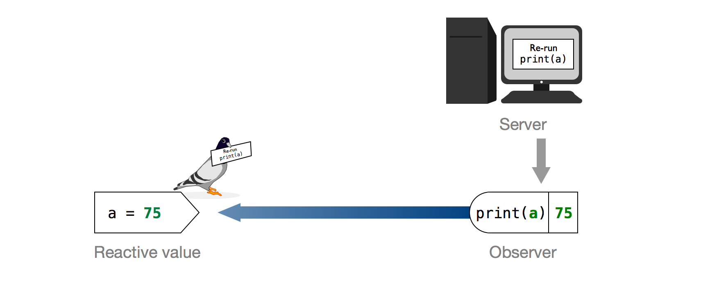

```{r setup, include=FALSE}
library(countdown)
library(tidyverse)
```

## Today

::: {.nonincremental}
1. **Warm-up:** something strange in a bootstrap app (9 min)
2. **Reactivity** (8 min) and fixing the bootstrap app (10 min)
3. **Fix our manager app** the same way: `v2` $\to$ `v3` (12 min)
4. **UI design:** what makes an app good, and how to lay it out: `v3` $\to$ `v4` (28 min)
:::

## Warm Up: on your own

::: {.task .nonincremental}
Open [`24-reactivity.R`](https://stat220-f26.github.io/files/24-reactivity.R) and run the app.

1. What changes when you change...
    a. the number of bootstrap resamples?
    b. the number of histogram bins?
    c. the confidence level?
2. Change **only** the bins. Besides the bin width, does the shape of the histogram change? Does the table change? Now change **only** the confidence level: should that need a brand new set of resamples?
:::

```{r}
#| echo: false
countdown(5)
```

## Warm Up: with your neighbors

::: {.task .nonincremental}
3. Compare notes. What did you notice?
4. Read the code in `renderPlot()` and `renderTable()`. What do they have in common?
:::

```{r}
#| echo: false
countdown(4)
```

. . .

Both `render` functions *each* run the whole bootstrap: `resample(obs_data, B = input$n_boot)`. Each runs its own simulation, so the plot and the table are summarizing *different* resamples, and changing only the **bins** or the **confidence level** reruns a slow simulation it doesn't need.

# Reactivity {.maize}

## Declarative programming

```{r eval=FALSE}
output$text <- renderText({
  print(input$a)
})
```

- **Doesn't** mean: print the value now and send it to the browser
- **Does** mean: this is the *recipe* for the output. Whenever `input$a` changes, follow the recipe again
    - Shiny, not you, decides *when* the code runs

## Reactive expressions

```{r echo=FALSE, out.width="70%"}

```

::: aside
Image credit: <https://shiny.rstudio.com/articles/understanding-reactivity.html>
:::

## Reactive expressions

- **Expression:** code that *produces a value*
- **Reactive:** *notices changes* in anything reactive it reads
- A **reactive expression** runs the first time it is called, then **caches** its result until something it depends on changes
- Create one by wrapping code in `reactive({ })`, and use it by calling it like a **function**: `df()`

## Example

```{r eval=FALSE}
server <- function(input, output, session) {
  output$plot <- renderPlot({
    plot(head(cars, input$nrows))
  })
  
  output$table <- renderTable({
    head(cars, input$nrows)
  })
}
```

. . .

`head(cars, input$nrows)` is written twice. Write it once:

```{r eval=FALSE}
server <- function(input, output, session) {
  df <- reactive({
    head(cars, input$nrows)
  })
  
  output$plot <- renderPlot({ plot(df()) })
  output$table <- renderTable({ df() })
}
```

## Where does `reactive()` go?

- It lives in the **server** function, *outside* the `render` functions
- It can use `input$...` values (just like a `render` function can)
- You call it with parentheses: `df()` (forgetting the `()` is the most common error!)
- The `render` functions can use it, and so can other reactive expressions

## Your turn: fix the bootstrap app

::: {.task .nonincremental}
5. Which task is *repeated* in both `render` functions? Which outputs need it?
6. Create a `reactive()` that holds the bootstrap resamples (put it **above** the `render` functions), and use it in both
7. Run the app. Now what happens when you change the number of bins? The confidence level? The number of resamples? Do the plot and table agree?
:::

```{r}
#| echo: false
countdown(10)
```

