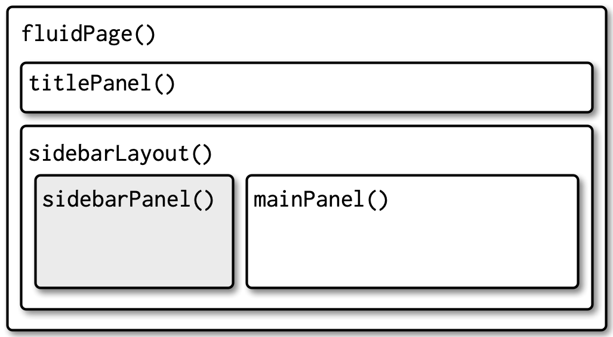
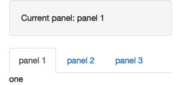

```{r setup, include=FALSE}
library(countdown)
library(tidyverse)
```

## Today

::: {.nonincremental}
1. What makes an app *good*? (6 min)
2. **Layout:** sidebar and tabs (15 min)
3. **Theme:** make it yours (10 min)
4. **Project structure** and re-deploying (15 min)
5. Work time: **sketch due today**, Portfolio 3 due Friday (rest of class)
:::

## Shiny: warm-up {.smaller}

::: {.task .nonincremental}
Open the following shinyapps and explore a little bit.

+ [Data Wrangling](https://psu-eberly.shinyapps.io/data_wrangling/)
+ [Biodiversity in NPS](https://abenedetti.shinyapps.io/bioNPS/)
+ [Hex Memory Game](https://dreamrs.shinyapps.io/memory-hex/)
+ [Lake Profile Dashboard](https://gallery.shinyapps.io/lake-profile-dashboard/)

With the folks around you, discuss:

1. Did any apps stand out as enjoyable or useful?
2. What features or design choices make an app stand out?
3. Are there any small tweaks that would make them more usable?
:::

```{r}
#| echo: false
countdown(6)
```

# Layout {.maize}

## Where we are

Our `v3` app is a single long column: every input, then every output. 

. . .

Today we reorganize it into the `v4` layout:

::: {.nonincremental}
- inputs in a **sidebar**
- each output on its own **tab**
:::

## Page with sidebar

:::: {.columns}

::: {.column width="45%"}
```{r}
#| eval: false

fluidPage(
  titlePanel("title"),
  sidebarLayout(
    sidebarPanel(
      # inputs
    ),
    mainPanel(
      # outputs
    )
  )
)
```
:::

::: {.column width="55%"}

:::
::::

## Tabs: `tabsetPanel()`

:::: {.columns}

::: {.column width="55%"}
```{r}
#| eval: false

mainPanel(
  tabsetPanel(
    tabPanel("Distribution", 
             plotOutput("salary_hist")),
    tabPanel("Individual salaries", 
             plotOutput("salary_jitter")),
    tabPanel("Data", 
             DT::dataTableOutput("data"))
  )
)
```
:::

::: {.column width="45%"}

:::
::::

## Other layouts (for your projects)

::: {.nonincremental}
- `fluidRow()` and `column()` for grids
- `navlistPanel()` and `navbarPage()` for multi-page apps
- See [Mastering Shiny, Chapter 6](https://mastering-shiny.org/action-layout.html)
:::

## Your turn: layout

::: {.task .nonincremental}
Open your `v3` app (or [`v3-reactive/app.R`](https://stat220-f26.github.io/files/shiny-apps/v3-reactive/app.R)).

1. Move the inputs into a `sidebarPanel()`, and the outputs into a `mainPanel()`
2. Put each plot, and the data table, on its own tab
3. Add a fourth tab: a line plot of the *average* salary for each education level (hint: `group_by(industry, education)`, `summarize()`, `geom_line()`)
:::

```{r}
#| echo: false
countdown(12)
```

# Theming {.maize}

## Built-in themes

```{r}
#| eval: false

fluidPage(
  theme = bslib::bs_theme(bootswatch = "flatly"),
  ...
)
```


## Interactive theming

Add `bslib::bs_themer()` to your server function to try out colors and fonts, and copy the settings that you like into `bs_theme()`:

```{r}
#| eval: false

server <- function(input, output, session) {
  bslib::bs_themer()
  ...
}
```

{width="50%" fig-align="center"}

## Make the plots match

```{r}
#| eval: false

thematic::thematic_shiny()   # put this near the top of app.R
```

- Plots drawn with `ggplot` then pick up the colors and fonts of the app theme
- Needs `{thematic}` 0.1.8 or newer (with ggplot2 4.0, older versions fail to start the app). Update with `install.packages("thematic")`

## Your turn: theme

::: {.task .nonincremental}
1. Pick a `bootswatch` theme, or customize with `bs_themer()`
2. Add `thematic::thematic_shiny()` and check that the plots match
3. Does the theme make the app easier or harder to read? (Check the contrast!)
:::

```{r}
#| echo: false
countdown(8)
```

# Project structure {.maize}

## A deployable app lives in a folder

```
my-app/
  app.R            <- the app
  data/
    manager-survey.rds
```

- The **whole folder** is deployed, so all files the app needs must be in it
- No other `.R` or `.qmd` files with `ui`/`server` in it. Only one `app.R`
- **Prepare your data separately** (`data-prep.R`), save it to `data/`, and read it in the app with a **relative path**

## Data prep script

```{r}
#| eval: false

# data-prep.R: run this once, NOT inside the app
library(tidyverse)

manager_survey <- read_rds("https://.../manager-survey-processed.rds") |>
  select(...) |>
  filter(annual_salary < 500000)

dir.create("data", showWarnings = FALSE)
write_rds(manager_survey, "data/manager-survey.rds")
```

```{r}
#| eval: false

# app.R
manager_survey <- read_rds("data/manager-survey.rds")   # relative path!
```

. . .

`"/data/manager-survey.rds"` (with the leading `/`) means the *root of your computer* and will fail.

## Your turn: restructure and re-deploy

::: {.task .nonincremental}
1. Move the data-preparation code into `data-prep.R` and write `data/manager-survey.rds`
2. Read the saved data in `app.R`
3. Re-deploy your app (same name, so the URL stays the same)
4. Test the new version in a private window
:::

```{r}
#| echo: false
countdown(10)
```

## Rest of class: work time

::: {.nonincremental}
- **Final project sketch** due today: see the [final project page](https://stat220-f26.github.io/portfolio/final.html)
- **Portfolio 3** (add interactivity to an earlier project) is due Friday. It needs *at least two* interactive components, and a published shiny app on shinyapps.io is the way to an "excellent"
- Ask for help with deployment now, not Thursday night!
:::
