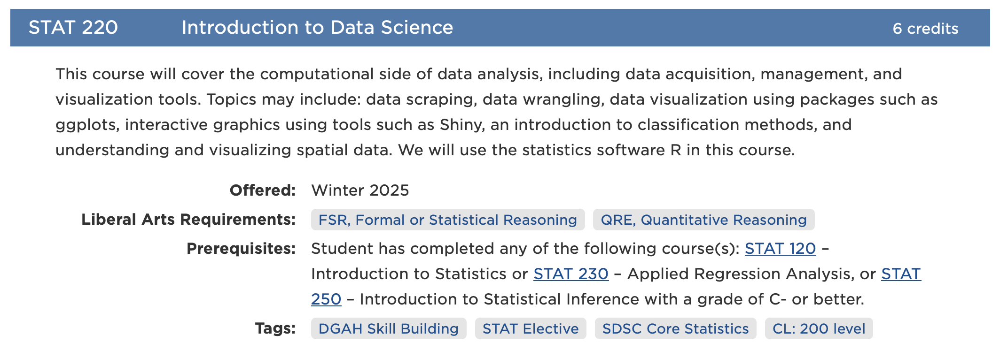
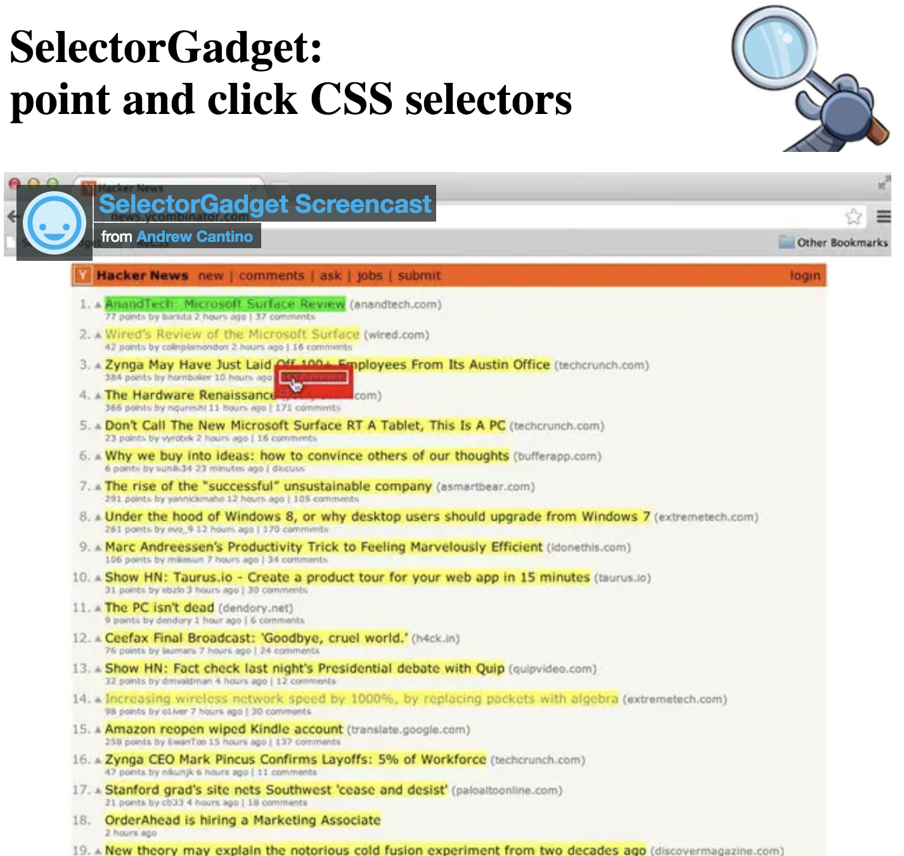
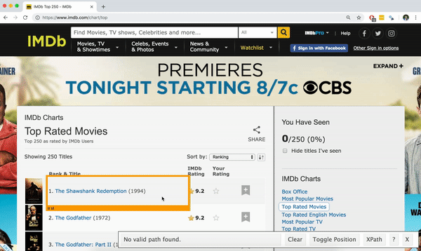
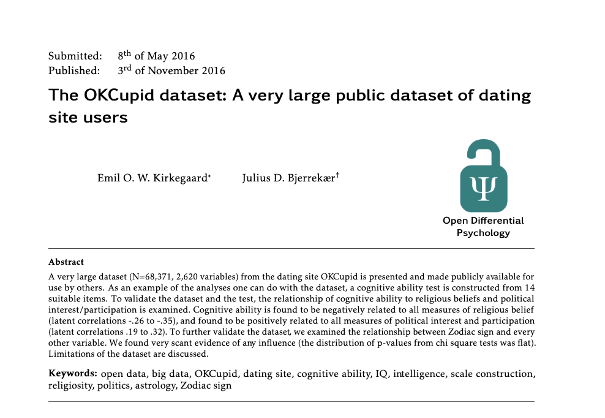
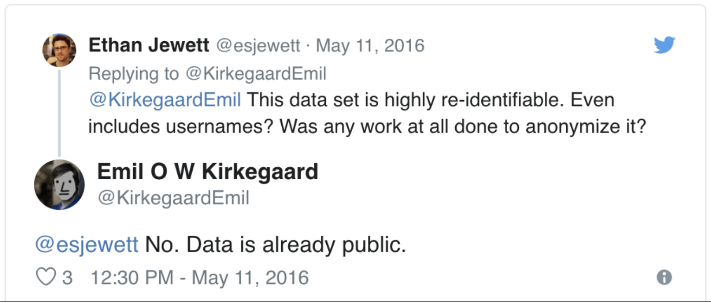

```{r setup, include=FALSE}
knitr::opts_chunk$set(echo = TRUE, message = FALSE, warning = FALSE)

library(countdown)
library(tidyverse)
library(rvest)
library(robotstxt)

slides_theme = theme_minimal(
  base_family = "Atkinson Hyperlegible",
  base_size = 16)

theme_set(slides_theme)
```

<!--
REVISED DAY 21. Changes from the old deck:
 - The IMDb scraping example (blocked by IMDb: robots.txt says no, and live requests now return a bot challenge)
   is replaced by two sites that *want* to be scraped: books.toscrape.com and quotes.toscrape.com.
 - The "what if a value is missing for some items?" lesson (IMDb: 245 of 250 MPAA ratings) now uses the Carleton
   catalog (prerequisites: 14 of 16 courses).
 - Carleton term is 26FA (works for any term: 25WI, 26SP, 26FA, 27WI all return data).
 - Multi-page scraping (map over page numbers + Sys.sleep) calls back to the iteration days.

Pacing for a 50-minute class:
  ~4  min  Recap: permission
  ~14 min  Carleton catalog: selectors, tibble, missing values
  ~3  min  SelectorGadget
  ~12 min  books.toscrape.com (Try it + fields + clean)
  ~10 min  Your turn: quotes.toscrape.com (+ multi-page)
  ~5  min  What if scraping doesn't work?, R scripts

Live chunks make a handful of requests to three sites at render time (catalog, books, quotes).
Saved copies are in saved-pages/ (move them to data/ if you want students to be able to use them as a fallback).
-->

## Today

::: {.nonincremental}
- Scrape data that **isn't** in a table, using CSS selectors
- Handle items with **missing** pieces
- Scrape **many pages** politely
- What to do when a website says no
:::

## Recap: check permission first

```{r}
paths_allowed("https://books.toscrape.com")
paths_allowed("https://www.imdb.com/chart/top")
```

. . .

- `TRUE`: the site's `robots.txt` allows it. `FALSE`: it doesn't, so **don't**
- `robots.txt` isn't the whole story: also read the terms of use, and don't send requests faster than a person would

## Core `rvest` functions {.smaller}

Function       | Description
---------------|---------------------------------------------
`read_html`    | Read HTML data from a url or character string
`html_element` | Select a specified element from HTML document
`html_elements`| Select specified elements from HTML document
`html_table`   | Parse an HTML table into a data frame
`html_text`    | Extract tag pairs' content
`html_name`    | Extract tags' names
`html_attrs`   | Extract all of each tag's attributes
`html_attr`    | Extract tags' attribute value by name

# Part 1: Carleton course catalog {.maize}

## Data aren't always stored as tables

<https://www.carleton.edu/catalog/current/search/?subject=STAT&term=26FA>



## Where is the data stored?

::: {.task .nonincremental}
View the page source to try to find the html elements where this data is located (e.g. 'h1', 'p', 'table')

- Course number
- Course title
- Course description
- Course meetings
- Faculty
:::

```{r}
#| echo: false
countdown(3)
```

##

```{r}
listings <- read_html("https://www.carleton.edu/catalog/current/search/?subject=STAT&term=26FA")
```

```{r}
listings |>
  html_elements("h3")
```

##

```{r}
listings |>
  html_elements("h3") |>
  html_text() |>
  str_squish()
```

# CSS selectors {.maize}

## Selecting the `courseNumber` class

Course numbers are between `<span class="courseNumber"> ... </span>` tags

These tags can be selected using `.` followed by the name of the class

```{r}
listings |>
  html_elements(".courseNumber") |>
  html_text()
```

## Scraping credits

```{r}
listings |>
  html_elements(".credits") |>
  html_text()
```

. . .

```{r}
listings |>
  html_elements(".credits") |>
  html_text() |>
  str_squish()
```

## Put the pieces together

```{r}
stat_courses <- tibble(
  course = listings |> html_elements(".courseNumber") |> html_text(),
  title = listings |> html_elements(".courseTitle") |> html_text(),
  credits = listings |> html_elements(".credits") |> html_text() |> str_squish(),
  description = listings |> html_elements(".courseDetailWrapper") |> html_text() |> str_squish()
)

stat_courses |> mutate(description = str_trunc(description, 50))
```

## What if a piece is missing for some courses?

Let's get the prerequisites:

```{r}
listings |>
  html_elements(".courseMeta--preReqs") |>
  html_text() |>
  length()
```

. . .

There are `r length(html_elements(listings, ".courseSearchResults > li"))` courses, but only `r length(html_elements(listings, ".courseMeta--preReqs"))` prerequisite lines. **Which courses are missing?** We can't tell: the missing ones just disappeared, so the vector no longer lines up with `stat_courses`.

## Select each course first, *then* extract

Each course is one `<li>` inside `.courseSearchResults`:

```{r}
courses <- listings |>
  html_elements(".courseSearchResults > li")

length(courses)
```

. . .

`html_element()` (singular) returns exactly one result per item, and `NA` when it is missing:

```{r}
prereqs <- courses |>
  html_element(".courseMeta--preReqs") |>
  html_text() |>
  str_squish()

length(prereqs)
sum(is.na(prereqs))
```

## Now it lines up

```{r}
tibble(
  course = courses |> html_element(".courseNumber") |> html_text(),
  prereqs = prereqs
) |>
  mutate(prereqs = str_trunc(prereqs, 60)) |>
  head(6)
```

## Sometimes, we can't get around regex :(

```{r}
listings |>
  html_elements(".classMeetings") |>
  html_text() |>
  str_squish() |>
  head(4)
```

## selectorGadget

::::: columns
::: {.column .nonincremental width="50%"}

- Open source tool that eases CSS selector generation and discovery

- Easiest to use with the [Chrome Extension](https://chromewebstore.google.com/detail/selectorgadget/mhjhnkcfbdhnjickkkdbjoemdmbfginb)

- Find out more on the [SelectorGadget vignette](https://rvest.tidyverse.org/articles/selectorgadget.html)
:::

:::{.column .nonincremental width="50%"}


:::
:::::

## selectorGadget

::::: columns
::: {.column .nonincremental width="50%"}

- Click on the app logo next to the search bar
- A box will open in the bottom right of the website
- Click on a page element (it will turn green), SelectorGadget will generate a minimal CSS selector for that element, and will highlight (yellow) everything that is matched by the selector
- Click on a highlighted element to remove it from the selector (red), or
click on an unhighlighted element to add it to the selector
:::

:::{.column .nonincremental width="50%"}



:::
:::::

# Part 2: A site that *wants* to be scraped {.maize}

## Books to Scrape

<https://books.toscrape.com>

A fake bookstore built for practicing web scraping.

::: {.task .nonincremental}
- Use SelectorGadget to explore the page
- What should the columns of our target dataset be? Do they correspond to specific CSS selectors?
:::

```{r echo=FALSE}
countdown(3)
```

## Each book is a "card"

```{r}
books_page <- read_html("https://books.toscrape.com/catalogue/page-1.html")

cards <- books_page |>
  html_elements("article.product_pod")

length(cards)
```

. . .

Just like the courses: **select the cards first, then extract from each one**.

## The title is in an *attribute*

The text on the page is cut off with "...", but the full title is in the link's `title` attribute:

```{r}
cards |>
  html_element("h3 a") |>
  html_text() |>
  head(3)
```

. . .

```{r}
cards |>
  html_element("h3 a") |>
  html_attr("title") |>
  head(3)
```

## Price and rating

```{r}
cards |>
  html_element(".price_color") |>
  html_text() |>
  head(3)
```

. . .

The rating is stored in the *class* of the star element (`<p class="star-rating Three">`):

```{r}
cards |>
  html_element(".star-rating") |>
  html_attr("class") |>
  head(3)
```

## Put the pieces together

```{r}
books <- tibble(
  title = cards |> html_element("h3 a") |> html_attr("title"),
  price = cards |> html_element(".price_color") |> html_text() |> parse_number(),
  rating = cards |> html_element(".star-rating") |> html_attr("class") |> str_remove("star-rating "),
  in_stock = cards |> html_element(".availability") |> html_text() |> str_squish() == "In stock"
) |>
  mutate(rating = factor(rating, levels = c("One", "Two", "Three", "Four", "Five")))

books
```

## One page is only 20 books

The URL changes with the page number:

::: {.nonincremental}
- `https://books.toscrape.com/catalogue/page-1.html`
- `https://books.toscrape.com/catalogue/page-2.html`
- ...
- `https://books.toscrape.com/catalogue/page-50.html`
:::

. . .

We know how to repeat things: **write a function, then `map` over the pages**

## A scraping function

```{r}
#| eval: false
scrape_books <- function(page) {
  url <- paste0("https://books.toscrape.com/catalogue/page-", page, ".html")
  cards <- read_html(url) |> html_elements("article.product_pod")

  tibble(
    title = cards |> html_element("h3 a") |> html_attr("title"),
    price = cards |> html_element(".price_color") |> html_text() |> parse_number(),
    rating = cards |> html_element(".star-rating") |> html_attr("class") |> str_remove("star-rating "),
    in_stock = cards |> html_element(".availability") |> html_text() |> str_squish() == "In stock",
    page = page
  )
}
```

## Be polite: slow down

```{r}
#| eval: false
books_1_to_3 <- map(1:3, \(p) {
  Sys.sleep(1)           # wait a second between requests
  scrape_books(p)
}) |>
  list_rbind()

books_1_to_3 |> count(rating)
```

```
# A tibble: 5 x 2
  rating     n
  <fct>  <int>
1 One       15
2 Two        8
3 Three     13
4 Four      10
5 Five      14
```

. . .

- `Sys.sleep()` keeps you from hammering the website
- Test on 2-3 pages **before** running all 50
- Save the result with `write_csv()` so you only scrape once

## Your turn: Quotes to Scrape {background-color="#F1DE6750"}

<https://quotes.toscrape.com>

::: {.task .nonincremental}
1. Check that scraping is allowed with `paths_allowed()`.
2. Scrape the **first page** into a tibble with the columns `text`, `author`, and `tags`.
    - Each quote can have *several* tags. How could you keep them in a single column?
3. *If you have time:* scrape pages 1-3. (*Hint:* look at how the URL changes on the "Next" button.)
:::

```{r echo=FALSE}
countdown(8)
```

## What if scraping doesn't work?

IMDb's Top 250 is a classic scraping example, but now:

```{r}
#| error: true
paths_allowed("https://www.imdb.com/chart/top")
read_html("https://www.imdb.com/chart/top") |> html_elements(".ipc-title__text") |> length()
```

. . .

1. Is there an **API** available? Can I access it as a student/researcher at no/low cost?
   - IMDb: yes, but cost prohibitive
2. Is there a **different website** with the same information?
   - [The Movie Database](https://www.themoviedb.org/) has an API
3. Is there a different scraping tool?
   - {RSelenium} drives a real browser, but it is beyond the scope of this course (and doesn't change the permission question!)
4. Is the data **really** necessary? Use a different data set.

## .qmd vs .R {.maize}

::::: columns
::: {.column .nonincremental width="50%"}

**Quarto document**:

  - Integrate code, text, and graphs
  - Output is a "report"
  - Code is run interactively (in chunks) and when rendering your final document
:::

:::{.column .fragment .nonincremental width="50%"}

**R script:**

  - A file that contains *only* R code
  - No "rendering": all code must be run explicitly
  - Useful for longer chunks of code
      - `data-cleaning.R`
      - `fit-models.R`
      - `scrape-data.R`

:::
:::::

## For scraping:

- We don't want to scrape a website more than we need to
- For homework, it's OK to keep scraping inside your .qmd unless specified
- For projects that involve intensive data-gathering:
    - use an R script to read in the "raw" data, clean it, and save it to a tidy csv
    - Read your "clean" data into your .qmd and proceed as usual

##

::::: columns
::: {.column .nonincremental width="50%"}

Dataset includes variables like:

- Political leanings
- Religion
- Drug usage
- Sexual preferences
- Zodiac sign
- With over 2,000 total variables (although not all users had all variables recorded)


:::

:::{.column .nonincremental width="50%"}



:::
:::::

##



## Follow-up study (and article correction)

<https://www.tandfonline.com/doi/abs/10.1080/10691898.2015.11889737>
