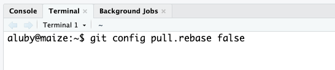

# GitHub merge conflicts

When you and your teammates work on the lines of code within a document and both try to push your changes, you *will* run into issues.

Merge conflicts happen when you merge files that have competing changes, and Git needs your help to decide which changes to incorporate in the final merge.

Our first task today is to walk you through a merge conflict!

First, a bit of Git review:

-   Pushing to a repo replaces the code on GitHub with the code you have on your computer.
-   If a collaborator has made a change to your repo and pushed it to your collaborative GitHub repository, GitHub will stop you from pushing your changes to the repo because this could overwrite your collaborator's work!
-   So you need to explicitly "merge" your collaborator's work before you can **push**.
-   If your and your collaborator's changes are in different files or in different parts of the same file, git merges the work for you automatically when you **pull**.
-   If you both changed the same part of a file, git will produce a **merge conflict** because it doesn't know which change you want to keep and which change you want to overwrite.

Git will put conflict markers in your code that look like:

```       
<<<<<<< HEAD 

See also: [dplyr documentation](https://dplyr.tidyverse.org/)   

======= 

See also [ggplot2 documentation](https://ggplot2.tidyverse.org/)  

>>>>>>> some1alpha2numeric3string4
```

The `===`s separate *your* changes (top) from *their* changes (bottom).

Note that on top you see the word `HEAD`, which indicates that these are your changes.

And at the bottom you see `some1alpha2numeric3string4` (well, it probably looks more like `28e7b2ceb39972085a0860892062810fb812a08f`).

This is the **hash** (a unique identifier) of the commit your collaborator made with the conflicting change.

Your job is to *reconcile* the changes: edit the file so that it incorporates the best of both versions and delete the `<<<`, `===`, and `>>>` lines.
Then you can stage and render the result.


## Setup

- Clone your portfolio 2 repo and open the writeup file
- Assign the numbers 1 and 2 to each team member
- If your partner(s) aren't here and you are currently a group of 1, let Amanda know ASAP
- **Both partners:** tell git how to combine changes when you pull. Open the `Terminal` (next to `Console`), type the command below, and hit enter. You only need to do this once.

```
git config pull.rebase false
```

```{r}
#| echo: false
#| fig-align: center
#| fig-alt: "The Terminal tab in RStudio with the command 'git config pull.rebase false' typed at the prompt."

```

::: callout-warning
## Warning!

Be careful about running git commands in the terminal if you don't know what you are doing. Ask for help from your group and Amanda before trying a bunch of random commands!
:::

::: callout-important
## Only commit `writeup.qmd`

For this activity, **only stage and commit the `.qmd` file.** When you render, output files will show up in your Git tab (for example `writeup.md`, `writeup.html`, `writeup.pdf`, or a `writeup_files` folder). **Do not check the box to stage them, and do not commit or push them.** Leave them unchecked. 

(When you submit your final project you will commit the rendered report, but not during this activity.)
:::

## Let's cause a merge conflict! 

Our goal is to see two different types of merges: first, a merge that git can't figure out on its own (a **merge conflict**) and that requires human intervention, then a merge that git can complete without any human intervention.

Doing this will require some tight choreography, so pay attention!

Take turns in completing the exercise, only one member at a time.
**Others should just watch, not doing anything on their own projects (this includes not even pulling changes!)** until they are instructed to.
If you feel like you won't be able to resist the urge to touch your computer when it's not your turn, we recommend putting your hands in your pockets or sitting on them!

### Before starting

Everyone should have the repo cloned and open in RStudio and know which role number(s) they are.

### Role 1

-   Go to `writeup.qmd` in your project repo. Change the `[authors]` to your actual name (not your partners!)
-   Render, then stage and commit **only** `writeup.qmd`, and push. (You should be able to see your changes on github.com)

::: callout-important
Make sure the previous role has finished before moving on to the next step.
:::

### Role 2

- Change the `[authors]` to be *your* name
- Render, then stage and commit **only** `writeup.qmd`
- Now, try to push your changes. You should get an error.

{fig-alt="A Git Push window in RStudio showing that the push was rejected: the command output ends with '! [rejected] HEAD -> main (fetch first)', followed by hints that the remote contains work you do not have locally and that you should integrate the remote changes, for example with git pull, before pushing again."}

- Pull. This should create a merge conflict. 

::: callout-tip
## Hint

If you see a message that says `You have divergent branches and need to specify how to reconcile them`, you skipped the setup step. Run `git config pull.rebase false` in the Terminal (see Setup), then pull again.
:::

- Resolve the conflict by editing `writeup.qmd` to include both of your names. Remove the merge conflict decorators (`<<<<<< HEAD`, `======`, and `>>>>>>> 97e290f39f197467b5563ea8f81187b760c95aa2`, the commit hash)
- Then, render the document
- In your Git tab, click the stage checkbox for **only** `writeup.qmd`. Make sure it has a check**mark**, not a filled-in box, and that the output files are unchecked
- Commit and push

::: callout-important
Make sure the previous role has finished before moving on to the next step.
:::

### Role 1 (again)

- In the body of the document (not in the header at the top), change one sentence of the text
- Render, then stage and commit **only** `writeup.qmd`, and push. You should get an error.
- Pull. No merge conflicts should occur, but you should see a message about merging
- Now push.

::: callout-important
Make sure the previous role has finished before moving on to the next step.
:::

### Role 2 (again)

- Pull all changes from the remote repo
- Change a *different* sentence in the body of the document (not the one Role 1 changed)
- Render, then stage and commit **only** `writeup.qmd`, and push. You should not get an error because you pulled first. This is "good" collaborative behavior: start with pulling before doing any work

::: callout-important
Done! Let Amanda know. 
:::


# Tips for collaborating via GitHub

- **Always pull before you start working**
- Resolve a merge conflict (render and push) *before* continuing your work. Never do new work while resolving a merge conflict
- Render, commit, and push often to minimize merge conflicts and/or make merge conflicts easier to resolve
- If you find yourself in a situation that is difficult to resolve, ask questions ASAP. Don't let it linger and get bigger. 

