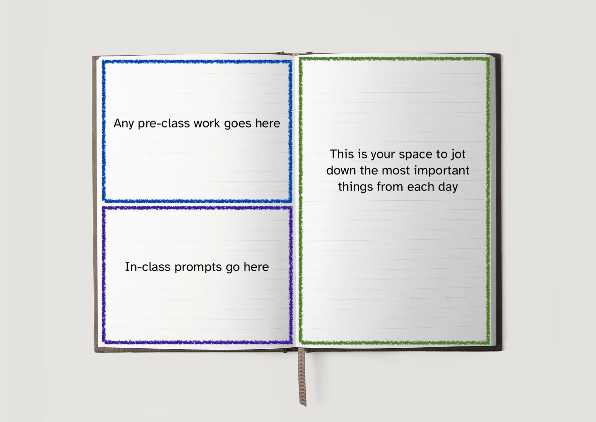
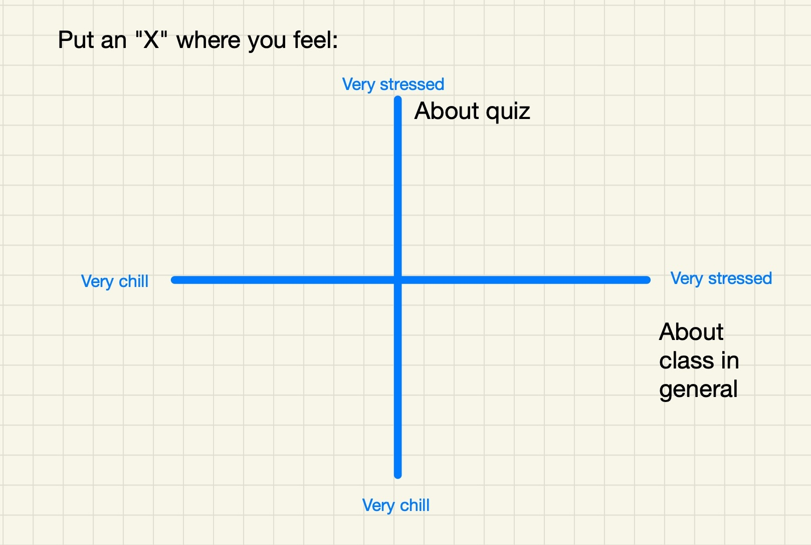

```{r setup, include=FALSE}
library(fontawesome)
```

Page 1: Leave blank for name/table of contents

After page 1, each course day will get two pages in "booklet style" 
    - Left, top: Prep/pre-work for the day (answer my question or jot down your own question, can be left blank)
    - Left, bottom: reflections from in-class prompt
    - Right: your space to summarize the main points for the day



# Table of Contents

*Note:* if you deviate from this ToC, that's perfectly fine! Just please keep your first page updated with what your ToC follows so I can find what I'm looking for

- Day4 | p2-3: Fill in at some point with `ggplot` and data visualization notes
- Day5 | p4-5: In-class: what is an example of data that would work well for a choropleth map? What about a proportional symbol map?
- Day6| p6-7: In class: what aspects of a graph made writing alt-text hard/easy? what aspects of an alt-text description made recreating the graph harder or easier?
- Day7 | p8-9: put an "X" where you currently feel about the quiz/class in general

{width="40%" fig-align="center" fig-alt="A blank graph with lab quiz on the y-axis and class in general on the x-axis. Negative values correspond to very chill and positive values correspond to very stressed."}

- Day8 | p10-11: Sketch the tidy version of the `bakeoff` dataset (see the original prompt in [slides09](https://stat220-f26.github.io/slides/08/slides08.html#/discuss))

- Day9: Quiz01! No journal entry

- Day10| p12-13: After completing the last prompt in the activity, tell me which dessert you would most like to sample from the list

- Day11 | p14-15: Sketch what the first 3 rows of `cafe_orders.csv` look like as raw text, then sketch the data frame R builds from it. Circle one place where the two don't match. What did R guess wrong, and how (in words!) you would fix it?

- Day12 | p16-17: 

- Day13 | p18-19: fill in the following bar graph: 

```{r}
#| fig-width: 5
#| fig-height: 2.5
#| fig-align: center
#| fig-alt: "A blank ggplot canvas with quiz2 topics on the y-axis and amount of time I need to dedicate to this topic on the x-axis"
#| echo: false


library(tidyverse)

topics <- c(
  "dplyr verbs",
  "group_by",
  "Joins and bind_rows",
  "pivot_longer and pivot_wider",
  "Dates and times",
  "Factors",
  "Importing data"
)

ggplot(tibble(topic = factor(topics, levels = rev(topics))),
       aes(x = 0, y = topic)) +
  geom_blank() +
  scale_x_continuous(limits = c(0, 10),
                     breaks = c(0, 10),
                     labels = c("none", "a lot")) +
  labs(x = "Amount of time I need to dedicate to this topic",
       y = NULL) +
  theme_minimal(base_size = 10) +
  theme(panel.grid.minor = element_blank())
```

- Day14 | p20-21: Work on the text analysis activity on `coursera` reviews, and tell me what you did and what you learned (this could be a graph, number, sentence description, etc.)

- Day15 | Quiz02! No journal entry

- Day 16 | p22-23: what is something you've done in this class (or previously) where a function would have been useful? 

- Day 17 | p24-25: Current confusion about collaborating on git/github

- Day 18 | p26-27: questions from class?

- Day 19 | p28-29: anything confusing or that sparked interest?