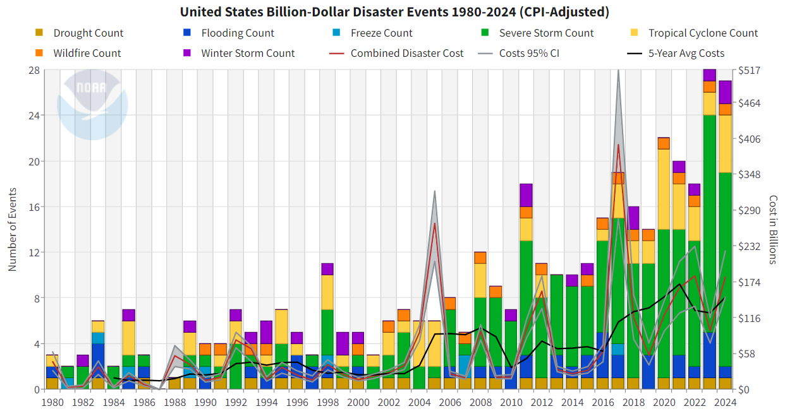

# Overview

For your second portfolio project, you'll apply what you've learned about wrangling, iteration and programming. We'll work with data from the NOAA on [Billion Dollar Disasters](https://www.ncei.noaa.gov/access/billions/time-series) in the U.S. 

One of the goals of this project is to get practice collaborating on code: splitting up a longer task, working in a shared repo, and putting your pieces together. These are skills you will use in almost any data science setting, and a little friction along the way is a normal and useful part of learning them.

Your task is to create an improved version of the graph below: 

At minimum, you should create two separate plots: 

  1. A bar graph of disaster type in each year
  2. A time series line plot of the combined (adjusted) cost for each year
  
To do so, you will need to programmatically read in a different CSV file for each year of the data, and combine them into a single dataset. This should include: 

  1. Writing a function called `read_disaster_data` that takes a file path and correctly reads and wrangles the corresponding data. You should pay attention to variable types (factors should be treated as factors, dates should be treated as dates, etc.)
      - The "Name" column should include only the name of the storm
      - You should add a new column called "Duration" that includes the duration of the disaster
      - You should add a new column for "Year" that is based on the original file that the data appeared in
  2. Using iteration (either map or a for-loop) to apply your function to each data set in the "data" folder
  3. Using `write_csv` to save your final dataset in your repo. (You likely do *not* want to save it in the `data/` folder)

If you get stuck, *R for Data Science* has a helpful section on [Reading Multiple Files](https://r4ds.hadley.nz/iteration.html#reading-multiple-files) that you may refer to. (But remember to reference it in your final report!)

You should write your code in quarto, create any graphics using `ggplot2`, and use tools from this class for data reading, wrangling, and iteration. To submit your work, push your repo to GitHub and submit to gradescope.

# Data 

The data for this portfolio problem is from the National Centers for Environmental Information at the National Oceanic and Atmospheric Administration.

Your repos will contain the following files:

- data/1980.csv
- data/1981.csv
- ...
- data/2024.csv

Where each dataset has the following variables:

| variable          | class      |
|-------------------|------------|
| Name              | character  |
| Disaster          | factor     |
| Begin Date        | date       |
| End Date          | date       |
| CPI-Adjusted Cost | numeric    |
| Unadjusted Cost   | numeric    |
| Deaths            | numeric    |

There are also two header rows that contain information about the dataset, but do not need to be read in to R. 

*A note on the data:* As of 2025, NOAA no longer updates this database. The files in your repo are an archive covering 1980 to 2024, which makes them a good opportunity to think about where data comes from and what happens when it stops being collected (see "Reading and reflection" below).

# Partner Project

This project is designed to be done with a partner, assigned by me. 

You may brainstorm with other people in the class, get feedback on graphs or output, and get conceptual help with debugging or errors, but you should not share code with anyone other than your partner. Your submission should reflect work that both of you understand. 

This project has two main pieces that fit together, so one way to split the work is:

- **Partner A: the function.** Write `read_disaster_data()`. Test it on a few files, including unusual ones (for example, a year with only one disaster and a year with the most).
- **Partner B: the iteration.** Apply the function to every file in the `data/` folder (using `map` or a for-loop), combine the results into one dataset, and save it with `write_csv()`. Check that the combined data look right (the number of rows, the years included, and that the variable types survived).

Then each of you makes one of the two required graphs, and each of you writes about your own part of the report. (The other is responsible for proofreading/editing) You can decide together who takes which role.

## Agree on how your pieces fit together

Before you start, agree on what `read_disaster_data()` takes in and what it gives back:

- **In:** one file path, such as `"data/1980.csv"`.
- **Out:** one data frame with the original seven columns (with the correct types), plus `Duration` and `Year`, where `Name` has the date information removed.

Partner B does not need to wait for Partner A. Until the real function is ready, you can use a simple stand-in function (like `read_csv`) that reads one file, and swap in the real one later without changing your iteration.

## A suggested timeline (not graded)

| Date | Suggested progress |
|---|---|
| Fri 10/23 | Both: read the prompt and open a few of the files. Agree on what the function takes in and returns. |
| Mon 10/26 | A: the function reads a file, parses the types, and adds `Year`. B: a loop that works with a stand-in function. |
| Wed 10/28 | A: `Name` and `Duration` finished and tested. B: combine the data with the real function and save it. |
| Fri 10/30 | Lab Quiz 3. Don't plan to work on the project today. |
| Weekend | Both: create the graphs and write reflection paragraph. Swap and review. |
| Wed 11/4 | Put together the final `.qmd`, polish the graphs, and proofread together. |

## Working in one repo

- **Pull before you start working**, and commit and push often. You will practice this in class on Friday.
- While you are developing, work in separate files (for example, `read_disaster_data.qmd` and `iteration.qmd`) so you don't edit the same lines. When you are ready, one of you copies everything into the single `.qmd` that you submit.
- Only one of you should be responsible for committing rendered files. Decide on the first day who will commit the output, and who will only render locally. 
- If you get a merge conflict, don't panic. Fix it before doing any new work, and ask me if you are stuck. 
- Both of you should have commits in the repo's history that reflect your own work.

## Check each other's work

Before you submit, swap parts and read each other's code. You should each be able to explain every line of the project, including the parts you did not write. I may ask either of you to explain any part of your submission.

## If things aren't going well

If you and your partner are having trouble coordinating, or one of you is struggling to keep up, talk about it early. If that doesn't resolve it, message me or come to office hours well before the due date. 

If one partner fails to meet agreed-upon due dates and disappears/does not communicate, I will split the group and each person will be responsible for the entire project on their own. The disappear-er will not be eligible for an "excellent" on this project, even on a revision.

# Reading and reflection: when a dataset stops

## Read

Read the following two short articles. The first reports on NOAA's announcement, and the second describes what happened next.

- [U.S. stops tracking costs of extreme weather disasters fueled by climate change](https://www.pbs.org/newshour/science/u-s-stops-tracking-costs-of-extreme-weather-disasters-fueled-by-climate-change) (PBS, May 2025)
- [The federal government used to keep track of extreme weather disasters. Now it's up to a nonprofit](https://www.ksl.com/article/news/utah/environment/the-federal-government-used-to-keep-track-of-extreme-weather-disasters-now-its-up-to-a-nonprofit/51588086) (KSL/CNN, October 2025)

For citing the data itself, NOAA asks for: *NOAA National Centers for Environmental Information (NCEI) U.S. Billion-Dollar Weather and Climate Disasters (2025). https://www.ncei.noaa.gov/access/billions/, DOI: 10.25921/stkw-7w73.* Please include this citation in your report.

## Reflect

At the end of your report, add a short section called "Reflection". Each partner should write their own paragraph responding to one of the prompts below. You and your partner should choose different prompts.

1. Where the data end: The data you used end in 2024. How should that shape the claims you make in your report, especially about trends? What would you want to say (or not say) about 2025/2026?
2. Combining old and new: The relaunched database says it uses the same methodology as the original, but some of its underlying loss data are proprietary and can't be independently checked. What would you want to know before joining the two datasets into one? Name two checks you could do.
3. Why you saved the data: This project asks you to save your combined dataset with `write_csv()`. Why might that matter more now than when the project was first written? What would someone else need from you (documentation, code, a citation) to reuse it?
4. Who is affected: The articles describe people who relied on this database. What do you think they lose when a dataset like this isn't updated, and what makes it hard for someone else to replace it?

Your reflection doesn't need to take a side on whether NOAA should have continued the database. I am looking for you to engage with the readings and connect them to what you saw in the data and your own analysis.

# Submission

Your submission will be a .qmd file that creates your two graphs. You should include a paragraph at the beginning that outlines what your code does. 

# Rubric

A **successful** project will:

-   [ ] Include all necessary components pushed to GitHub and linked to gradescope
-   [ ] Demonstrate a history of work in progress and revision through your git commit history, including resolving at least one merge conflict
-   [ ] Contain code, plots, and written summary in a single .qmd document
-   [ ] The .qmd has all necessary and no unnecessary code
-   [ ] Replicate the bar plot and time-series plot (separately!!)
-   [ ] Your file contains a function called `read_disaster_data` that: 
      - [ ] Imports a user-specified file
      - [ ] Parses all variable types correctly (e.g. dates are treated as dates, factors are treated as factors)
      - [ ] Edits the "Name" column to remove the date information
      - [ ] "Duration" column is included
      - [ ] "Year" column is included
-   [ ] Data sets were correctly combined
-   [ ] All wrangling was implemented correctly 
-   [ ] Saves the combined data as a new file
-   [ ] Includes the data citation, and a reflection that responds to two of the prompts and refers to at least one of the readings
-   [ ] Meet minimum submission quality standards
    -   [ ] Very few grammatical mistakes, spelling mistakes, or typos
    -   [ ] Informative title for your report is included
    -   [ ] Any graphs are readable with appropriate titles and labels
    -   [ ] The rendered document is `pdf` or `gfm` format (so I can see the rendered report via github)
    -   [ ] The rendered document does not contain any unnecessary content (package loading messages, warnings, etc.)

An **excellent** project will meet all of the requirements for a successful project, plus

-   [ ] Both partners have substantial commits in the repo history across all parts of the code/writing
-   [ ] Includes your knitted report as the GitHub readme of your repo (e.g. when I open your repo, the initial page should be your final report). You will need to render to `gfm` and then rename the rendered file as  `README.md`
- [ ] Improved graphs make substantial changes to `geom` or `aesthetic` layers. Think major overhaul rather than replicating the original. Your improvements should be creative, but still faithfully represent the underlying data.
-   [ ] The reflection makes a specific connection to the analysis, for example a caveat added to a graph, a concrete check you ran or would run, or a documented decision about the data. (A guideline: could this reflection have been written without doing the project? If yes, it probably won't check this box)
- [ ] Meet high submission quality standards
    -   [ ] No grammatical mistakes, spelling mistakes, or typos
    -   [ ] Graphs have been customized (theme, color palette, scales, etc.) 

# Reminder about collaboration (other than your partner)

You may brainstorm with other people in the class, get feedback on any graphs or output, and get conceptual help with debugging or errors, but you should not be sharing code. All work that you submit should be your own. If you do use any resources, they should be properly cited in your report. (I don't care what citation style you use, as long as it is consistent and contains (a) the title and author of the resource, (b) a link to the resource, and (c) a brief description of what you used it for)

From the syllabus: *You are expected to collaborate with your group, but cannot rely on external sources other than to help motivate the questions or provide other background information (including online forums like StackExchange or Reddit). You may use any resources from class and package documentation, but getting answers on significant parts of solutions from outside resources is not allowed.*

A note/reminder on AI: *Large-language models (e.g. ChatGPT, Gemini, etc.) should only be used for coding or debugging help after you’ve attempted to solve the problem on your own. You should never copy and paste any course materials into a large-language model, and you should never copy and paste anything out of a large-language model into your course materials. Copying, paraphrasing, summarizing, or submitting work generated by anyone but yourself without proper attribution is considered academic dishonesty (this includes output from LLMs). You are not allowed to upload datasets or assignment prompts into a large language model.*

There are *lots* of ways to do this task! I am looking for evidence that you can correctly implement the tools that we've discussed in class. If I notice code that looks very different than what we've used in course materials, I won't be able to assess whether you've learned the tools from the class and will request a revision. I will refer extreme cases to the ASC. 

# FAQ

If you have any questions, please post them to Ed! 
