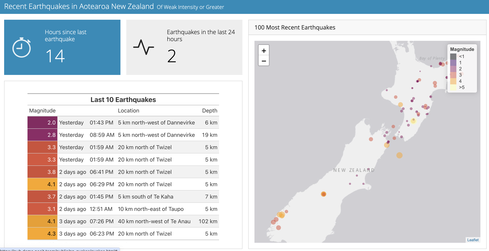

```{r setup, include=FALSE}
knitr::opts_chunk$set(echo = TRUE, message = FALSE, warning = FALSE)

library(countdown)
library(tidyverse)
library(lubridate)
library(palmerpenguins)
library(patchwork)
library(ggthemes)
library(nycflights23)
library(here)
library(httr2)
library(rvest)
slides_theme = theme_minimal(
  base_family = "Atkinson Hyperlegible",
  base_size = 16)

theme_set(slides_theme)
```


```{r}
#| echo: false

gapminder <- read_csv(here("data", "gapminder2021.csv"))
gapminder2021 <- gapminder %>%
  filter(year == 2021)
```

## Today

::: {.nonincremental}
1. *Why* add interactivity? 
2. The toolkit: **plotly**, **leaflet**, **{DT}**
3. Putting it together in a **dashboard** 
:::
## Features we'll focus on in this class

- Hovering
  - Display additional information about an observation or group via cursor
- Changing the representation of the data
  - User decides if they want to see the data in a table or a graph
  - Option to select variables, graph type, or tweak parameters
- Filtering/subsetting
  - Allow user to control which subset of the data is shown

## Workflow

1. Start with a static graph, describe what insights it offers, *then* build up
2. Show how the interactive features give you insight *that you would not otherwise be able to get*
    - Just because you *can* doesn't mean you *should*
3. Document how to use the features ("click on the drop down menu to choose a variable")

## Explanation $\to$ Exploration

Interactive components sit somewhere on an "explanation / exploration" spectrum

- **Exploration:** open-ended; the user decides what the story is
  - [NCAA Swimming](https://gpilgrim.shinyapps.io/SwimmingProject-Click/) Data Explorer
  - [Economic Census Industry Data](https://www.census.gov/library/visualizations/interactive/economic-census-industry-data-by-geography.html)
- **Explanation:** the story is the same regardless of what the user does
  - [Shadow Peace](http://www.fallen.io/shadow-peace/1/)
  - [Euro Final](https://data-kicks.github.io/euro_final_scrollytelling_analysis/euro_final_scrollytelling_analysis.html)

. . .

(You looked at the [NZ earthquake dashboard](https://pub.demo.posit.team/public/nz-quakes/quakes.html) and the [htmlwidgets showcase](https://testing-apps.shinyapps.io/flexdashboard-storyboard/) to prepare for today: which sat where?)

# plotly {.maize}

## plotly

- A library for interactive, web-based graphics
- Works in the viewer, in HTML documents, dashboards and shiny apps
- The easy way in: take a ggplot you already have and wrap it in `ggplotly()`

## A static plot

```{r static-plot}
#| output-location: column

gap2021 <- gapminder %>%
  filter(year == 2021) %>%
  ggplot(aes(x = income, y = life, color = four_regions, size = population)) +
  geom_point() +
  labs(
    x = "GDP per capita",
    y = "Life expectancy",
    color = "Region"
  ) +
  scale_x_continuous(labels = scales::dollar_format()) +
  theme_minimal()

gap2021
```

## Static &rarr; interactive

```{r plotly1}
library(plotly)
ggplotly(gap2021)
```

## Wouldn't it be nice if we could see the country name when we hover? 

. . . 

```{r}
#| code-line-numbers: "7"
#| output-location: slide

gap2021 <- gapminder %>% 
  filter(year == 2021) %>%
  ggplot(aes(x = income, 
             y = life, 
             color = four_regions, 
             size = population,
             text = country)) +
    geom_point() +
  labs(
    x = "GDP per capita",
    y = "Life expectancy",
    color = "Region"
  ) +
  scale_x_continuous(labels = scales::dollar_format()) +
  theme_minimal()

ggplotly(gap2021)
```

## Wouldn't it be nice if we could see **only** the country name when we hover? 

. . . 

```{r}
ggplotly(gap2021, tooltip = "text")
```

## Your turn: plotly

::: {.task .nonincremental}
Make a scatterplot of `body_mass_g` vs. `flipper_length_mm` from `penguins`, with color and shape for `species`. Then convert it with `ggplotly()`.

- What tooltips are included by default?
- Change the tooltip to include "Species"
- (If time) use `stringr` so the tooltip shows "Species: Adelie" instead of "Adelie"

Then discuss: what does this interactivity add? is it useful?
:::

```{r}
#| echo: false
countdown(7)
```

# Leaflet {.maize}

## Leaflet

- A JavaScript library AND an R package for interactive maps
- Open source
- You build a map in layers with the pipe: `leaflet() |> addTiles() |> ...`

. . . 

```{r}
library(leaflet)

leaflet() |>
  addTiles()
```

## Adding lat/long and a zoom (trial and error)

```{r}
leaflet() |>
  addTiles() |>
  setView(lng = -93.1560, lat = 44.4614, zoom = 15)
```

## Markers and popups

```{r}
leaflet() |>
  addTiles() |>
  setView(lng = -93.1560, lat = 44.4614, zoom = 15) |>
  addMarkers(
    lng = -93.153617, 
    lat = 44.462511,
    popup = "Here is the <b>Math & Stat Dept</b>"
  )
```

## Your turn: leaflet

::: {.task .nonincremental}
The three islands in `penguins` and their (approximate) locations:

```{r}
islands <- tibble(
  island = c("Biscoe", "Dream", "Torgersen"),
  lat = c(-64.80, -64.73, -64.77),
  lng = c(-63.77, -64.23, -64.08)
)
```

Make a leaflet map with a marker for each island, and a popup with the island's name.

(*Hint:* `addMarkers()` can take a data frame and formulas: `lng = ~lng, lat = ~lat, popup = ~island`. Start zoomed out.)
:::

```{r}
#| echo: false
countdown(5)
```

# Data tables {.maize}

## {DT}: DataTables

By default R prints a tibble like code. {DT} makes a table people can sort, search and page through:

```{r}
library(DT)
datatable(gapminder2021, rownames = FALSE, filter = "top")
```

## Table options

```{r}
gapminder2021 |> 
  select(country, four_regions, income, life, population) |>
  datatable(
    rownames = FALSE,
    filter = "top",
    options = list(pageLength = 5)
  ) |>
  formatStyle(columns = 1:5, fontSize = "12pt")
```

## Your turn: DT

::: {.task .nonincremental}
Make a {DT} table of the `penguins` data. Add the filter option and make the text 14pt.
:::

```{r}
#| echo: false
countdown(3)
```


# Dashboards {.maize}

## A dashboard puts the pieces on one page

::::: columns
::: {.column .nonincremental width="45%"}
It is a Quarto document with a different `format`:

```yaml
---
title: "Palmer Penguins"
format:
  dashboard:
    orientation: columns
    theme: yeti
---
```
:::

:::{.column .nonincremental width="55%"}



:::
:::::

## Layout: pages, rows and columns

::::: columns
::: {.column .nonincremental width="50%"}
Markdown headings make the layout:

- `#` starts a new **page** (navigation bar)
- `##` starts a new **row** or **column** (depends on `orientation`)
- Each code chunk is a **card**. Use `#| title:` to name it
:::

:::{.column .nonincremental width="50%"}
```markdown
# Graphs

## Column {width=65%}

(a plot chunk)

## Column {width=35%}

(two more chunks)
```
:::
:::::

## Value boxes and themes

A chunk with `content: valuebox` makes a big number:

````markdown
```{{r}}
#| content: valuebox
#| title: "Penguins"
#| icon: "bug"
#| color: "primary"
list(value = nrow(penguins))
```
````

Change the look of the whole dashboard with `theme:` in the YAML. See the [Quarto dashboard docs](https://quarto.org/docs/dashboards/theming.html) for the options.

## Putting it all together

::: {.task .nonincremental}
Download [`22-dashboard-example.qmd`](https://stat220-f26.github.io/files/22-dashboard-example.qmd) and render it. Then improve it:

1. Make the graphs plotly's with good tooltips
2. Replace the data output with your {DT} table
3. Add a new *page* with your leaflet map
4. (if time) Add a value box for each island (the number of penguins that live there) on the map page
5. (if time) Change the theme

:::

```{r}
#| echo: false
countdown(15)
```

## For Friday

::: {.nonincremental}
- **Portfolio 3** (add interactivity to an earlier project or homework problem): at least two interactive components
- Pick one: 📺 [Shiny basics playlist](https://carleton.hosted.panopto.com/Panopto/Pages/Viewer.aspx?pid=637ed93b-d906-4ed7-86d0-afac0023b3d7) or 📚 [Ch 1-2 of Mastering Shiny](https://mastering-shiny.org/basic-app.html)
:::


```{r}
#| echo: false

countdown(3)
```
