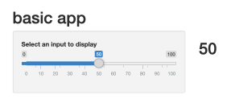
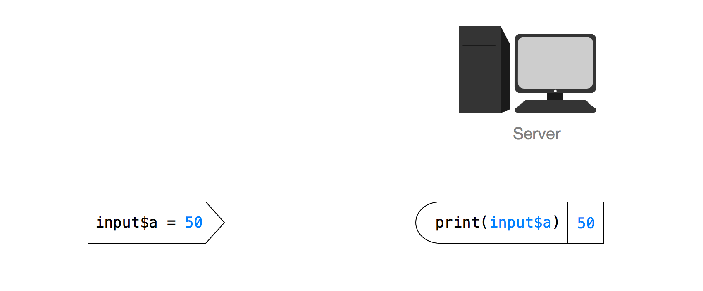
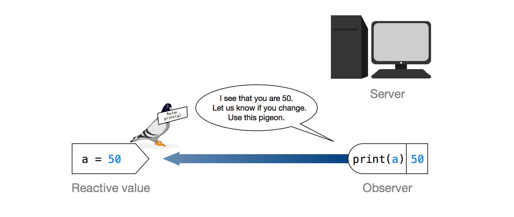
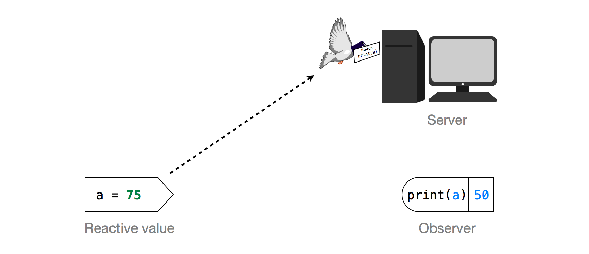
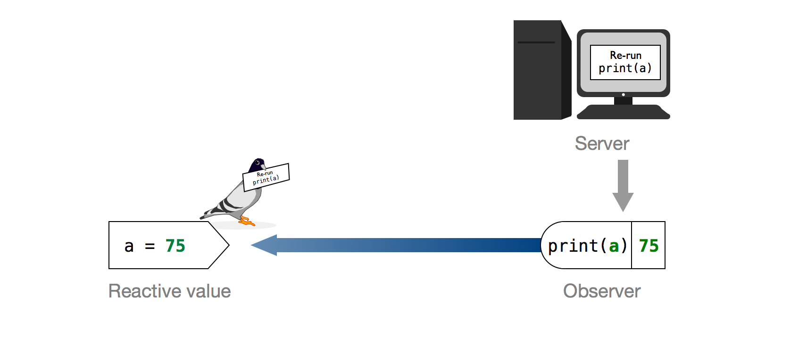
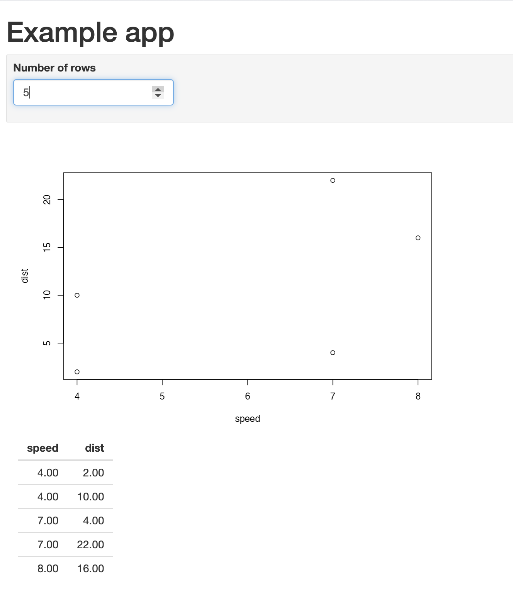
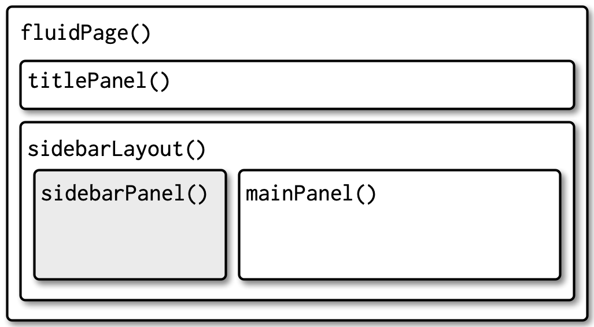
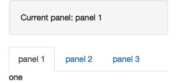

```{r setup, include=FALSE}
knitr::opts_chunk$set(echo = TRUE, message = FALSE, warning = FALSE)

library(countdown)
library(tidyverse)
library(lubridate)
library(palmerpenguins)
library(patchwork)
library(ggthemes)
library(nycflights23)
library(here)
library(httr2)
library(rvest)
slides_theme = theme_minimal(
  base_family = "Atkinson Hyperlegible",
  base_size = 16)

theme_set(slides_theme)
```


## Warm Up: on your own

::: {.task .nonincremental}
Start by opening [`bootstrap-start/app.R`](https://github.com/stat220-f26/stat220-f26.github.io/blob/main/files/apps/bootstrap-start/app.R) (click **Copy raw file**, then paste it into a new `app.R`)

1.  To begin, you need to understand what the Shiny app is doing. Run the Shiny app. What output changes when you change...

  a.  the number of bootstrap resamples?

  b.  the number of histogram bins?

  c.  the confidence level?

2.  Looking back at #1, are there any surprises? Does anything change/update unexpectedly? Does anything fail to update?
:::

```{r}
#| echo: false
countdown(3)
```

## Warm Up: in groups of ~3

::: {.task .nonincremental}
3.  Discuss your answers to Part 1 with your group and be ready to report back.

4.  Read through the code in the `renderPlot()` and `renderTable()` expressions. Note the key tasks executed within each.

5.  Based on your answers to #4, Is there any replication? That is, are any key tasks executed multiple times? Record your group's answers and be ready to report back.
:::

```{r}
#| echo: false
countdown(4)
```

# Reactivity {.maize}


## Very basic app

::: columns
::: {.column width="50%"}
```{r eval=FALSE}
# app.R
library(shiny)

ui <- fluidPage(
  headerPanel("basic app"),
  
  sidebarPanel(
    
    sliderInput("a", 
      label = "Select an input to display",
      min = 0, max = 100, value = 50)
  ),
      
  mainPanel(h1(textOutput("text")))
)

server <- function(input, output) {
    output$text <- renderText({
      print(input$a)
    })
}

shinyApp(ui = ui, server = server)
```
:::

::: {.column width="50%"}

:::
:::::

## Declarative programming

```{r eval=FALSE}
output$text <- renderText({
  print(input$a)
})
```

-  DOESN'T mean: print the value and send it to the browser

- DOES mean: this code is the recipe that should be used to print the output
    - if `input$a` changes, use this recipe

## Very basic app


```{r echo=FALSE}

```

::: aside
Image credit: https://shiny.rstudio.com/articles/understanding-reactivity.html
:::

## How does `print(input$a)` know when to change?

```{r echo=FALSE}

```
::: aside
Image credit: https://shiny.rstudio.com/articles/understanding-reactivity.html
:::


## Reactivity via carrier pigeon

```{r echo=FALSE}

```

::: aside
Image credit: https://shiny.rstudio.com/articles/understanding-reactivity.html
:::

## Reactivity via carrier pigeon

```{r echo=FALSE}

```

::: aside
Image credit: https://shiny.rstudio.com/articles/understanding-reactivity.html
:::

## Reactive expressions

- Two definitions:
    + Expression: Code that *produces a value*
    + Reactive: *Detects changes* in anything reactive it reads

- **Reactive expression:** only runs the first time it is called and then it caches its result until it needs to be updated

- create a reactive expression by wrapping a block of code in `reactive({...})`

- use a reactive expression by calling it like a function

## Example

::: panel-tabset

### screenshot

```{r}
#| echo: false

```

### ui

```{r eval=FALSE}
ui <- fluidPage(
  h1("Example app"), # Level-1 header
    inputPanel(
      numericInput("nrows", "Number of rows", 10)
    ),
    mainPanel(
      plotOutput("plot"),
      tableOutput("table")
    )
)
```

### server

```{r eval=FALSE}
server <- function(input, output, session) {
  output$plot <- renderPlot({
    plot(head(cars, input$nrows))
  })
  
  output$table <- renderTable({
    head(cars, input$nrows)
  })
}
```

:::

## Reactive expressions reduce duplication

To reduce duplication, we can create a *reactive expression* for the data selected

```{r eval=FALSE}
server <- function(input, output, session) {
  # Creating a reactive expression for the data
  df <- reactive({
    head(cars, input$nrows)
  })
  
  output$plot <- renderPlot({
    plot(df()) # Now we have to call df() like a function
  })
  
  output$table <- renderTable({
    df()
  })
}
```

## Your turn: fix the bootstrap app

::: {.task .nonincremental}
6. Which task is *repeated* in both `render` functions? Which outputs need it?
7. Create a `reactive()` that holds the bootstrap resamples (put it **above** the `render` functions), and use it in both
8. Run the app. Now what happens when you change the number of bins? The confidence level? The number of resamples? Do the plot and the table agree?
9. Compare the new code with the original: what is easier to read?
:::

```{r}
#| echo: false
countdown(10)
```

## Back to the manager app: `v2` $\to$ `v3`

Open your own version from Friday, or paste in [`v2-filter/app.R`](https://github.com/stat220-f26/stat220-f26.github.io/blob/main/files/apps/v2-filter/app.R). The filter appears **twice**:

::: {.task .nonincremental}
10. Create a reactive expression called `filtered()` and use it in both plots
11. Add `req(input$industry)` as the first line of `filtered()`. Uncheck everything. What changed?
12. Add a third output that uses `filtered()`: `textOutput("n_respondents")` that says "Showing 7,003 respondents"
13. Add a `DT::dataTableOutput("data")` that shows the filtered data
:::

```{r}
#| echo: false
countdown(10)
```

## `req()` and `validate()`

```{r eval=FALSE}
filtered <- reactive({
  req(input$industry)          # stop quietly until something is checked
  manager_survey |>
    filter(industry %in% input$industry)
})
```

- `req()` silently stops the app from running the rest of the code if the input is empty (no angry red error)
- `validate(need(..., "message"))` is the version that shows the user a message

# UI design {.maize}

## Some basic design principles

::: {.nonincremental}
- **Group related inputs** and put them where people expect them (usually a sidebar)
- **One idea per output:** put separate views on separate tabs instead of one very long page
- **Say what the user is looking at:** titles, axis labels, and "Showing 7,003 respondents"
- **Sensible defaults:** the first thing the user sees should already show something interesting
- **Fewer choices are better:** 25 checkboxes is a lot. Would a drop-down be better?
- **Label inputs in plain words** (not `xcol`)
:::

## Where we are

Our `v3` app is a single long column: every input, then every output.

. . .

Today we reorganize it into the `v4` layout:

::: {.nonincremental}
- inputs in a **sidebar**
- each output on its own **tab**
:::

## Page with sidebar

:::: {.columns}

::: {.column width="45%"}
```{r}
#| eval: false

fluidPage(
  titlePanel("title"),
  sidebarLayout(
    sidebarPanel(
      # inputs
    ),
    mainPanel(
      # outputs
    )
  )
)
```
:::

::: {.column width="55%"}

:::
::::

## Tabs: `tabsetPanel()`

:::: {.columns}

::: {.column width="55%"}
```{r}
#| eval: false

mainPanel(
  tabsetPanel(
    tabPanel("Distribution", 
             plotOutput("salary_hist")),
    tabPanel("Individual salaries", 
             plotOutput("salary_jitter")),
    tabPanel("Data", 
             DT::dataTableOutput("data"))
  )
)
```
:::

::: {.column width="45%"}

:::
::::

## Other layouts (for your projects)

::: {.nonincremental}
- `fluidRow()` and `column()` for grids
- `navlistPanel()` and `navbarPage()` for multi-page apps
- See [Mastering Shiny, Chapter 6](https://mastering-shiny.org/action-layout.html)
:::

## Your turn: layout

::: {.task .nonincremental}
Open your `v3` app (or [`v3-reactive/app.R`](https://github.com/stat220-f26/stat220-f26.github.io/blob/main/files/apps/v3-reactive/app.R)).

1. Move the inputs into a `sidebarPanel()`, and the outputs into a `mainPanel()`
2. Put each plot, and the data table, on its own tab
3. Give each input a plain-language label, and add axis labels to the plots
4. Add a fourth tab: a line plot of the *average* salary for each education level, with one line per selected industry (hint: `group_by(industry, education)`, `summarize()`, `geom_line()`, and use `filtered()`)
:::

```{r}
#| echo: false
countdown(10)
```

## For Wednesday

::: {.nonincremental}
- **Wednesday we make it look good and put it online.** Please create a (free) account at [posit connect cloud](https://connect.posit.cloud/) and bring your login info to class
- Final project **sketch** is due Wednesday (see the [final project page](https://stat220-f26.github.io/portfolio/final.html))
:::
