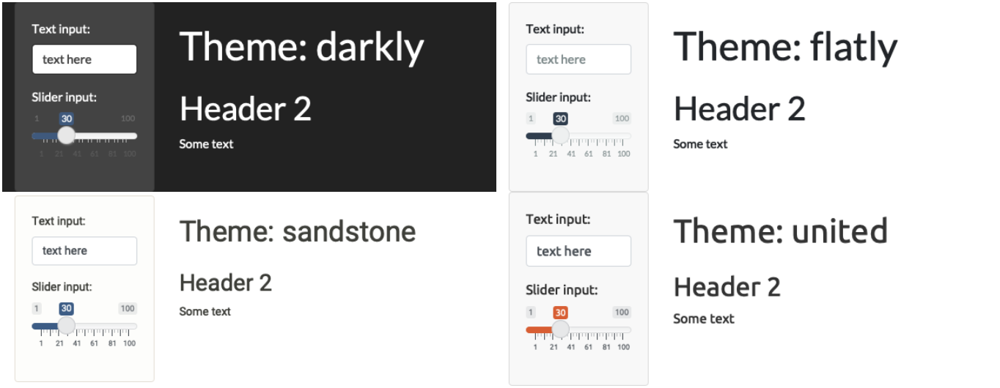
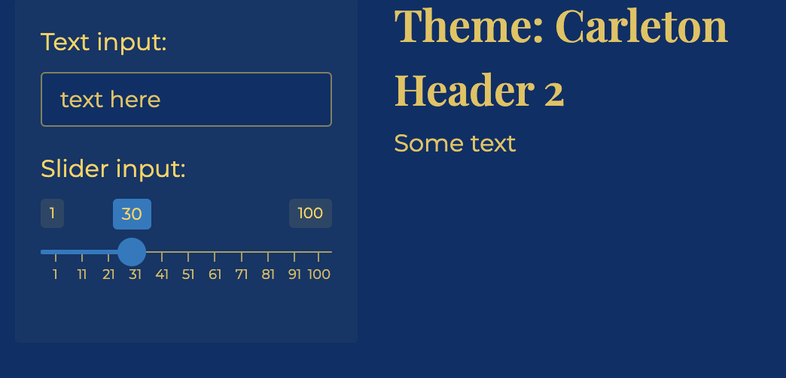
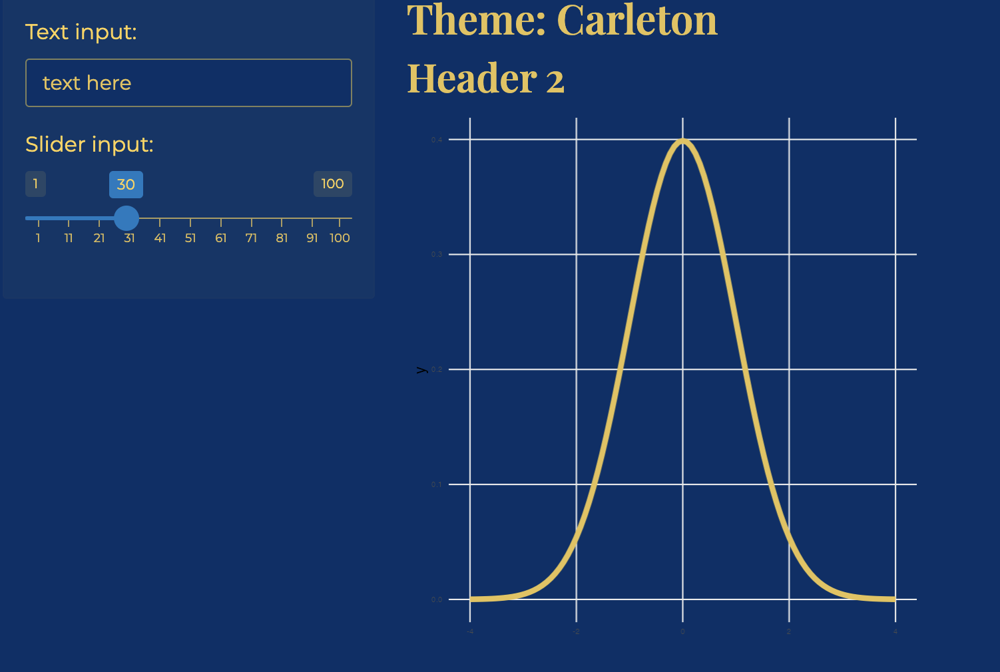
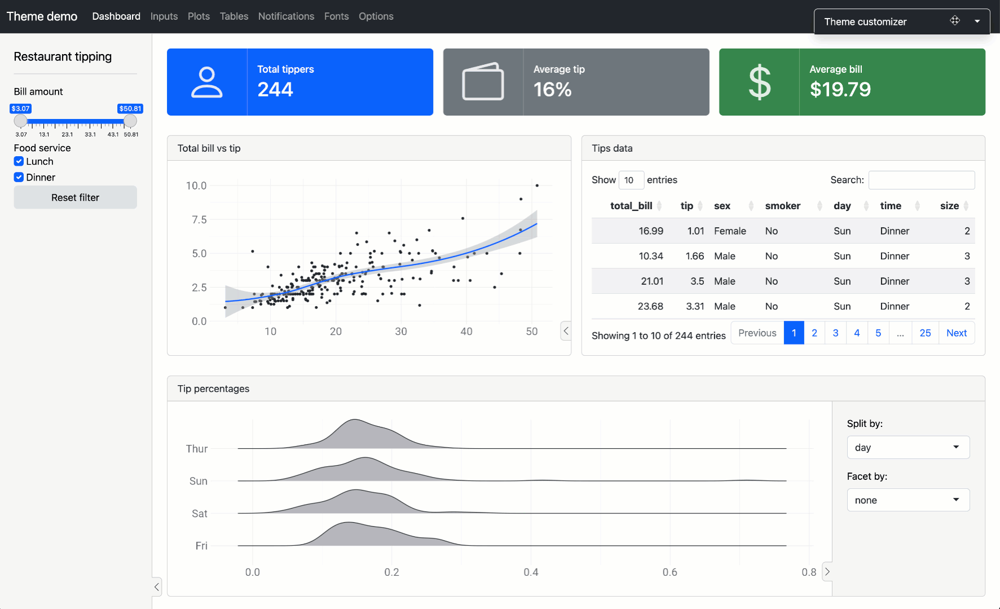

```{r setup, include=FALSE}
knitr::opts_chunk$set(echo = TRUE, message = FALSE, warning = FALSE)

library(countdown)
library(tidyverse)
library(lubridate)
library(palmerpenguins)
library(patchwork)
library(ggthemes)
library(nycflights23)
library(here)
library(httr2)
library(rvest)

slides_theme = theme_minimal(
  base_family = "Atkinson Hyperlegible",
  base_size = 16)

theme_set(slides_theme)
```

## Group Contract

```{r}
#| echo: false

countdown::countdown(6)
```

## Shiny: warm-up {.smaller}

::: {.task .nonincremental}
Open the following shinyapps and explore a little bit. 

+ [Data Wrangling](https://psu-eberly.shinyapps.io/data_wrangling/)
+ [Biodiversity in NPS](https://abenedetti.shinyapps.io/bioNPS/)
+ [Hex Memory Game](https://dreamrs.shinyapps.io/memory-hex/)
+ [Lake Profile Dashboard](https://gallery.shinyapps.io/lake-profile-dashboard/)
+ [Classification Trees](https://asluby.shinyapps.io/GSS_classification/)

With the folks around you, discuss: 

1. Did any apps stand out as enjoyable or useful? 
2. What features or design choices make an app stand out? 
3. Are there any small tweaks you could make to make them more usable?
:::

```{r}
#| echo: false

countdown::countdown(6)
```

## Today

::: {.nonincremental}
1. **Theming:** make it yours 
2. **Project structure:** an app that can be deployed 
3. **Deploying** to shinyapps.io 
4. Work time: **sketch due today**, Portfolio 3 due Friday
:::

. . .

Start from your `v4` app (or [`v4-layout/app.R`](https://github.com/stat220-f26/stat220-f26.github.io/blob/main/files/apps/v4-layout/app.R)) 


# Theming {.maize}

## Theming: built-in themes

```{r}
#| eval: false


fluidPage(
  theme = bslib::bs_theme(bootswatch = "flatly"),
  ...
)
```



## Theming: customize {.nostretch}

```{r}
#| eval: false

fluidPage(
  theme = bslib::bs_theme(
    bg = "#003069", 
    fg = "#ffd24f", 
    base_font = "Montserrat",
    heading_font = "Playfair Display SemiBold"
)
```

{width="50%" fig-align="center"}


## Plot theming {.nostretch}

```{r}
#| eval: false
#| code-line-number: 2

server <- function(input, output, session) {
  thematic::thematic_shiny()
  
  output$distPlot <- renderPlot({
    ggplot(...)
  })
}
```


{width="50%" fig-align="center"}

## {.nostretch}

Add `theme = bslib::bs_theme()` to your `ui()` function, and `bslib::bs_themer()` to your server function to try out different options interactively



## Theming and accessibility

::: {.nonincremental}
- Is there enough **contrast** between text and background? (Light text on a light background is the most common problem.)
- Don't rely on color alone to carry meaning (use labels, shapes, or a colorblind-friendly palette)
- Is the font big enough to read from a projector?
:::

## Your turn: theme

::: {.task .nonincremental}
1. Add a `bootswatch` theme to your app, or customize with `bs_themer()`
2. Add `thematic::thematic_shiny()` and check that the plots match
3. Check the contrast and the font sizes. Would someone with low vision be able to read your app?
:::

```{r}
#| echo: false
countdown(10)
```


# Project structure {.maize}

## A deployable app lives in a folder

```
my-app/
  app.R            <- the app
  data/
    manager-survey.rds
```

- The **whole folder** is deployed, so every file the app needs must be in it
- Only one `app.R`, and no other `.R` or `.qmd` files with a `ui` and `server`
- **Prepare your data separately** (`data-prep.R`), save it to `data/`, and read it in the app with a **relative path**

## Data prep script

```{r}
#| eval: false

# data-prep.R: run this once, NOT inside the app
library(tidyverse)

manager_survey <- read_rds("https://.../manager-survey-processed.rds") |>
  select(...) |>
  filter(annual_salary < 500000)

write_rds(manager_survey, "data/manager-survey.rds")
```

```{r}
#| eval: false

# app.R
manager_survey <- read_rds("data/manager-survey.rds")   # relative path!
```

`"/data/manager-survey.rds"` (with the leading `/`) means the *root of your computer*, and will fail.

## The same idea for your whole project repo

A repo that someone else can navigate looks like:

```
my-project/
  README.md          <- link to the published project, what's where
  data-prep.R        <- gets/cleans the data (scripts, in order)
  data/              <- the cleaned data
  app/               <- the shiny app (a deployable folder)
    app.R
    data/
  report.qmd         <- the written report, if you have one
```

- Clear file names ("analysis-final-v2-REAL.R" is not one)
- No leftover files; the README says which file to open first

## Your turn: restructure

::: {.task .nonincremental}
1. Make a new folder for the app, with a copy of your `app.R`
2. Move the data-preparation code into `data-prep.R` (in the folder), run it, and check that `data/manager-survey.rds` exists
3. Read the saved data in `app.R` with a relative path
4. Run the app from this folder. Does it still work?
:::

```{r}
#| echo: false
countdown(5)
```

# Deploying {.maize}

## Where can an app live?

- A Shiny app needs **R running behind it**, so it can't be a static website (unlike a Quarto page)
- Posit connect cloud: A free account gives you 5 apps and a limited number of active hours per month
- Your app is **public**. Don't deploy anything with data that you don't have permission to share

## Publishing from RStudio

::: {.nonincremental}
1. Open `app.R` and click the blue **Publish** button at the top right of the editor
2. It might prompt you to connect a publishing account. Click **posit connect cloud**. 
    - Otherwise, click "add new account"
3. Check that `app.R` **and** `data/manager-survey.rds` are ticked, and give the app a title
4. Click **Publish** and wait 
5. Copy the URL and test it in a **private window**
:::

## When it fails

::: {.nonincremental}
- Read the **deployment log** (the Deploy tab in RStudio) from the bottom up
- *"file not found"*: the data file is not in the folder, or the path is wrong (leading `/`, or absolute like `/Users/...`)
- *"there is no package called..."*: the app uses a package that is only loaded in your session. Put every `library()` call in `app.R`
- Works on your laptop but not online? Use a relative path, and don't read from your Desktop or Downloads folder
- The app takes a while to wake up the first time (and "sleeps" when no one has used it for a bit)
:::

## Your turn: deploy

::: {.task .nonincremental}
1. Deploy your app to posit connect cloud
2. Open the URL in a private window and test every input and tab
3. Add the URL to your README (and share it with someone near you to test!)
:::

```{r}
#| echo: false
countdown(15)
```

## Rest of class: work time

::: {.nonincremental}
- **Final project sketch** due today: see the [final project page](https://stat220-f26.github.io/portfolio/final.html)
- **Portfolio 3** (add interactivity to an earlier project) is due Friday. It needs *at least two* interactive components, and a published shiny app on shinyapps.io is the way to an "excellent"
- Ask for help with deployment now, not Thursday night!
:::
