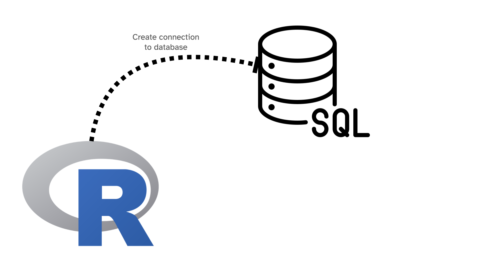
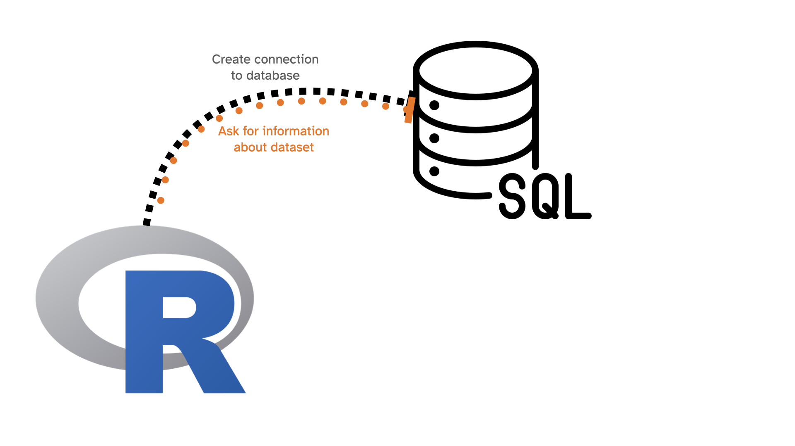
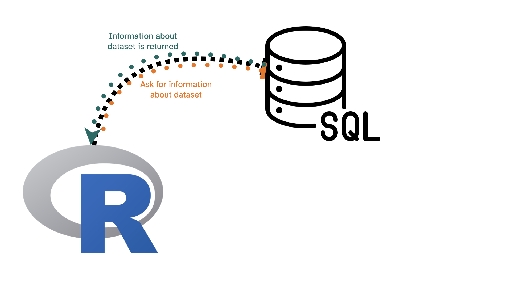
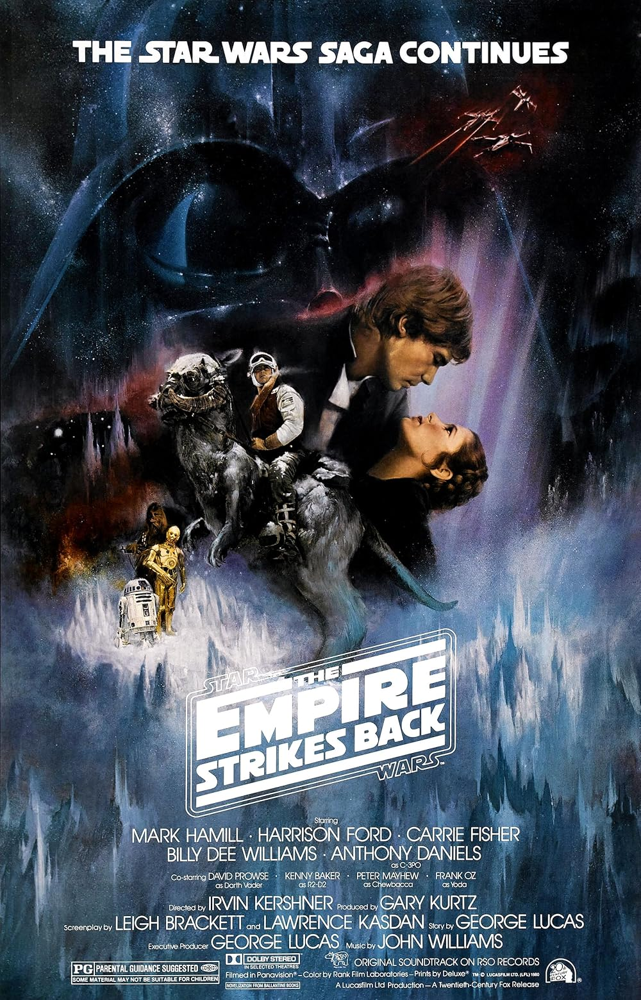
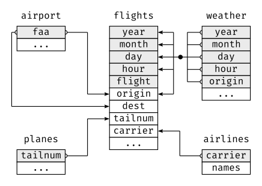

```{r setup, include=FALSE}
knitr::opts_chunk$set(echo = TRUE, message = FALSE, warning = FALSE)

library(countdown)
library(tidyverse)
library(nycflights23)

slides_theme = theme_minimal(
  base_family = "Atkinson Hyperlegible",
  base_size = 16)

theme_set(slides_theme)
```

## Warm Up: on your own

::: {.task .nonincremental}
Using `nycflights23::flights`, answer the following using {dplyr} code

- How many flights are in this dataset?
- How many flights flew to MSP from JFK in 2023?
- What was the average flight delay for MSP flights in Sept 2023?
:::

```{r}
#| echo: false
countdown(3)
```

## `nycflights23::flights` is a subset of all flights data


```{r}
nycflights23::flights |>
  select(year) |>
  distinct()
```
. . . 

```{r}
nycflights23::flights |> 
  summarize(n = n())
```

. . . 

```{r}
nycflights23::flights |>
  select(origin) |>
  distinct()
```


## We can also connect to a database containing more flights data:

```{r}
#| eval: false
library(mdsr)
library(DBI)
db <- dbConnect_scidb("airlines")
```

```{r}
#| eval: false
flights <- tbl(db, "flights")
carriers <- tbl(db, "carriers")
airports <- tbl(db, "airports")

class(flights)
```
```
[1] "tbl_MariaDBConnection" "tbl_dbi"               "tbl_sql"              
[4] "tbl_lazy"              "tbl"      
```

## We can access information about `flights` with {dplyr} commands: {.smaller}

```{r}
#| eval: false
flights |>
  select(year) |>
  distinct()
```

```
# Source:   SQL [?? x 1]
# Database: mysql  [mdsr_public@mdsr.crcbo51tmesf.us-east-2.rds.amazonaws.com:3306/airlines]
   year
  <int>
1  2013
2  2014
3  2015
```
. . . 

```{r}
#| eval: false
flights |> summarize(n = n())
```
```
# Source:   SQL [?? x 1]
# Database: mysql  [mdsr_public@mdsr.crcbo51tmesf.us-east-2.rds.amazonaws.com:3306/airlines]
         n
   <int64>
1 18008372
```
::: aside
*Warning:* slow! 
:::


## What is happening?



## What is happening?



## What is happening?




## Under the hood: 

```{r}
#| eval: false

flights |>
  select(origin) |>
  distinct()
```

is generating the following SQL code: 

```{r}
#| eval: false
<SQL>
SELECT DISTINCT `origin`
FROM `flights`
```

and sending the request to the SQL server where the data lives. The result then gets sent back to R

## SQL

SQL stands for **S**tructured **Q**uery **L**anguage and is a language for database management systems developed in the 1970's

- Up to this point, we've been working with *small* data
  - Can be saved on our personal computers
  - Can be loaded directly into R's memory
- Moving into *medium* data: 
  - Can be saved on our personal computers
  - **Can't** be loaded or worked with in R's memory

## SQL 

There are many "dialects" of SQL, but they're all very similar

  - Oracle/MySQL
  - Microsoft SQL Server
  - SQLite
  - MariaDB is a community version of MySQL
  
. . . 

The "dialect" we'll use is MySQL/MariaDB

## SQL

- LOTS of data science jobs expect some basic SQL knowledge
- Databases are a "safer" way to store data within an organization than passing around .csv files
- Point of the next few days is to show you the basics and build a little bit of familiarity with the commands
- The good news: "thinking" in SQL is similar to "thinking" in {dplyr} (even though the syntax is different)

## SQL in R

To run SQL in R, use 

```{r}
#| eval: false
dbGetQuery(db, "<INSERT SQL QUERY HERE>")
```

. . . 

```{r}
#| eval: false
dbGetQuery(db, 
"SELECT DISTINCT `origin`
FROM `flights`")
```

```
    origin
1      ABE
2      ABI
3      ABQ
4      ABR
5      ABY
6      ACK
7      ACT
8      ACV
9      ACY
10     ADK
...
```


# A quick overview of SQL commands

## `SELECT` and `FROM`

are required for every query. The simplest query we can write is: 

```{r}
#| eval: false

SELECT * FROM flights;
```

which means "select everything from the flights dataset". 

. . . 

**DO NOT EXECUTE THIS QUERY!** This will cause all 18 million records to be dumped! This will not only crash your computer, but also tie up the server for everyone else. 

A safe version is: 

```{r}
#| eval: false

SELECT * FROM flights LIMIT 0,10;
```

## `LIMIT`

is similar to `head()` or `slice()`

```{r}
#| eval: false
dbGetQuery(db, 
"SELECT DISTINCT `origin`
FROM `flights`
LIMIT 0,5")
```
```
  origin
1    ABE
2    ABI
3    ABQ
4    ABR
5    ABY
```

## Your turn

::: {.task .nonincremental}
Run the following code to connect to the imdb database. It lives on a shared, read-only server, so please keep your queries small (use `LIMIT`).

```{r}
#| eval: false
library(mdsr)
library(DBI)
db <- dbConnect_scidb(dbname = "imdb")
```

Check that your connection works by running the following "query"

```{r}
#| eval: false

dbGetQuery(db, "SELECT * FROM kind_type
             LIMIT 0,10;")
```

What `kind_type` number corresponds to "movies"?
:::

```{r}
#| echo: false

countdown::countdown(1)
```


## Two tables: 

::::: columns

::: {.column width="40%"}

`kind_type` is a "lookup table" for the `kind_id` variable

```{r}
#| eval: false

dbGetQuery(db, "SELECT * FROM kind_type
             LIMIT 0,10;")
```

```
  id           kind
1  1          movie
2  2      tv series
3  3       tv movie
4  4    video movie
5  5 tv mini series
6  6     video game
7  7        episode
```

:::

::: {.column width="60%"}

`title` has information about "titles" in imdb

```{r}
#| eval: false

dbGetQuery(db, "SELECT * FROM title
             LIMIT 0,10;")
```

- `id`
- `title`
- `imdb_index`
- `kind_id`
- `production_year`
- etc.

:::

:::::

## `WHERE` is similar to `filter()`

::::: columns

::: {.column width="40%"}

{width="80%"}

:::

::: {.column width="60%"}

```{r}
#| eval: false

dbGetQuery(db, "SELECT *
              FROM title
              WHERE title = 'The Empire Strikes Back';")
```

```
        id                   title imdb_index kind_id production_year  
1   476823 The Empire Strikes Back       <NA>       7            1980      
2   461950 The Empire Strikes Back       <NA>       7            2015     
3   919851 The Empire Strikes Back       <NA>       7            2015    
4   924929 The Empire Strikes Back       <NA>       7            2017   
5  1751199 The Empire Strikes Back       <NA>       7            2003   
6  1890901 The Empire Strikes Back       <NA>       7            2016   
7  2530173 The Empire Strikes Back       <NA>       7            2005   
8  2780701 The Empire Strikes Back       <NA>       7            1986   
9  2916719 The Empire Strikes Back       <NA>       7            2012  
10 4346960 The Empire Strikes Back       <NA>       6            1992   
```

:::

:::::

## Restricting to `kind_id = 1`

```{r}
#| eval: false
dbGetQuery(db, "SELECT *
              FROM title
              WHERE title = 'The Empire Strikes Back'
                AND kind_id = 1;")
```

```
 [1] id              title           imdb_index      kind_id         production_year imdb_id         phonetic_code  
 [8] episode_of_id   season_nr       episode_nr      series_years    md5sum         
<0 rows> (or 0-length row.names)
```

Now we get zero results! 

## Soften search so no longer need exact match with `LIKE`

- Similar to regex
- `%` is the "wildcard" character in SQL

. . . 
```{r}
#| eval: false
dbGetQuery(db, "SELECT *
              FROM title
              WHERE title LIKE '%The Empire Strikes Back%'
                AND kind_id = 1;")
```
 
. . . 

```
       id                                          title imdb_index kind_id production_year imdb_id phonetic_code
1 4260164 Star Wars: Episode V - The Empire Strikes Back       <NA>       1            
2 4346961       The Empire Strikes Back Part II (Parody)       <NA>       1 
```

## `ORDER BY` is like `arrange()` 

```{r}
#| eval: false
dbGetQuery(db, "SELECT title, kind_id, production_year
              FROM title
              WHERE title LIKE '%The Empire Strikes Back%'
                AND kind_id = 1
             ORDER BY production_year;")
```
```
                                           title kind_id production_year
1 Star Wars: Episode V - The Empire Strikes Back       1            1980
2       The Empire Strikes Back Part II (Parody)       1            2016
```

## Your turn

::: {.task .nonincremental}
1.  Find your favorite movie in the `title` table
2. Find [Viola Davis](https://www.imdb.com/name/nm0205626/?ref_=nv_sr_1) in the `name` table 
3.  Make note of Viola Davis's `id` (you may find more than one row: write down all of them)
:::

*Note:* The first few rows/columns of the `name` table look like this: 

```
     id                        name imdb_index imdb_id gender name_pcode_cf
1   235 -Alverio, Esteban Rodriguez       <NA>      NA      m         A4162
2   921       Aaberge, Theodor Olai       <NA>      NA      m         A1623
3  1698                     Aarudra       <NA>      NA      m          A636
4  1189              Aaltonen, Miro       <NA>      NA      m         A4356
5  2755            Abbas, Mubasshir       <NA>      NA      m         A1251
6  2821             Abbasi, Kurosch       <NA>      NA      m         A1262
7   779            A., Narayana Rao       <NA>      NA      m         A5656
```

```{r}
#| echo: false
countdown(3)
```

## Extracting table info 

The following code chunk lists all of the tables available in the IMDB

```{r}
#| eval: false
table_names <- dbListTables(db)
table_names
```

```
 [1] "title"           "link_type"       "person_info"     "movie_info"     
 [5] "movie_companies" "complete_cast"   "movie_keyword"   "company_type"   
 [9] "keyword"         "role_type"       "movie_link"      "cast_info"      
[13] "company_name"    "kind_type"       "aka_title"       "char_name"      
[17] "name"            "info_type"       "comp_cast_type"  "aka_name"       
[21] "movie_info_idx" 
```

and we can pull out fields (columns) in each table with `dbListFields`

```{r}
#| eval: false
dbListFields(db, "title")
```
```
 [1] "id"              "title"           "imdb_index"      "kind_id"        
 [5] "production_year" "imdb_id"         "phonetic_code"   "episode_of_id"  
 [9] "season_nr"       "episode_nr"      "series_years"    "md5sum"  
 ```

## Your turn

::: {.task .nonincremental}
List the fields in the `name`, `cast_info`, and `char_name` tables. Do they have fields in common? How do you think these tables fit together?
:::

```{r}
#| echo: false
countdown(3)
```

## Finding cast info for *The Empire Strikes Back*

```{r}
#| eval: false
dbGetQuery(db,
"SELECT *
 FROM cast_info
 WHERE movie_id = 4260164
 LIMIT 0,10;")
```

```
        id person_id movie_id person_role_id         note nr_order role_id
1   456375     64737  4260164          77625 (uncredited)       NA       1
2   831054    110718  4260164          23193 (uncredited)       NA       1
3   988117    131244  4260164         149050         <NA>        8       1
4  1321284    173608  4260164          23193 (uncredited)       NA       1
5  1838022    240742  4260164         366363         <NA>       25       1
6  1918455    251152  4260164          23193 (uncredited)       NA       1
7  1918456    251152  4260164         380517 (uncredited)       NA       1
8  1918457    251152  4260164           3008 (uncredited)       NA       1
9  1918458    251152  4260164         380518 (uncredited)       NA       1
10 2421549    314562  4260164         470037 (uncredited)       NA       1
```

There are 162 rows in all. Each row is one person playing one role in the movie.

## Relational databases

Most databases contain multiple *tables* that are linked together via *keys* 


::::: columns
::: {.column width="50%"}
```{r}
nycflights23::flights |>
  select(origin, dest, arr_delay, sched_arr_time)
```
:::

::: {.column width="50%"}
```{r}
nycflights23::airports |>
  select(faa, name)
```
:::

:::::

## Relational databases

Most databases contain multiple *tables* that are linked together via *keys* 

::::: columns
::: {.column width="50%"}
```{r}
#| eval: false
survivoR::castaways
```
```{r}
#| echo: false
survivoR::castaways |>
  select(season, castaway_id, castaway, city) 
```
:::

::: {.column width="50%"}
```{r}
#| eval: false
survivoR::confessionals
```
```{r}
#| echo: false
survivoR::confessionals |>
  select(season, episode, castaway_id, count = confessional_count)  
```
:::

:::::

## These relationships are often summarized with a *schema*

- All *tables* are listed
- Any variables that are *shared* across tables are listed
- All *relationships* between variables are connected with a line
- Other variables may or may not be included

## Schema: nycflights23 tables

{.r-stretch}

## `JOIN`s in SQL

::::: columns
::: {.column width="50%"}
```{sql}
--| eval: false

SELECT *
FROM table1
JOIN table2 ON table1.key=table2.key
```
:::
::: {.column width="50%"}
- Select (everything) from first dataset
- Join second dataset
- On specified "keys" for each table
:::
:::::

## Joining `cast_info` with `name`

```{r}
#| eval: false

dbGetQuery(db, "SELECT name.name, cast_info.role_id, cast_info.id
              FROM cast_info 
              JOIN name ON name.id = cast_info.person_id
              WHERE cast_info.movie_id = 4260164;")
```
```
                    name role_id       id
1          Anderson, Bob       1   456375
2           Austen, Alan       1   831054
3           Baker, Kenny       1   988117
4        Bear, Lightning       1  1321284
5             Boa, Bruce       1  1838022
6      Bonehill, Richard       1  1918455
7      Bonehill, Richard       1  1918456
8      Bonehill, Richard       1  1918457
9      Bonehill, Richard       1  1918458
10     Buchanan, Stephen       1  2421549
...
```

# Interlude: SQL in Quarto

## SQL chunks

Instead of wrapping a query in `dbGetQuery()`, you can write SQL directly in a SQL chunk. First connect in an R chunk (as before), then:

````markdown
```{{sql}}
--| connection: db
SELECT * FROM kind_type LIMIT 0,3;
```
````

- `connection: db` tells the chunk which R object holds your database connection
- Options in a SQL chunk start with `--|` (SQL comments), not `#|`
- Add `--| output.var: kinds` to also save the result as an R data frame called `kinds`
- The query is the same, whichever way you run it

## Your turn

::: {.task .nonincremental}
1. You found several rows named "Davis, Viola" in `name`. Which `id` has rows in `cast_info` (where it is called `person_id`)?

2. Keep only her rows as an actress: `role_id = 2`. (`role_type` is the lookup table for `role_id`, like `kind_type` was for `kind_id`.)

3. Add the names of the characters she played by `JOIN`ing the `char_name` table (`person_role_id` in `cast_info` matches `id` in `char_name`)
:::

```{r}
#| echo: false
countdown(5)
```


## Counting: `COUNT()`

`COUNT(*)` is like `n()`: it counts rows

```{r}
#| eval: false
dbGetQuery(db,
"SELECT COUNT(*) AS n_movies
 FROM title
 WHERE kind_id = 1;")
```

```
  n_movies
1  1061161
```

## `GROUP BY` gives one row per group

```{r}
#| eval: false
dbGetQuery(db,
"SELECT production_year, COUNT(*) AS n_movies
 FROM title
 WHERE kind_id = 1 AND production_year BETWEEN 2000 AND 2020
 GROUP BY production_year
 ORDER BY n_movies DESC
 LIMIT 0,5;")
```

```
  production_year n_movies
1            2016    59702
2            2014    57983
3            2015    56561
4            2013    53855
5            2017    53459
```

- Like `group_by()` + `summarize()`. Other summaries: `AVG()`, `SUM()`, `MIN()`, `MAX()`
- `AS` names the new column, and `ORDER BY` can sort by that name
- Every column in `SELECT` that is *not* a summary must also be in `GROUP BY`

## Your turn

::: {.task .nonincremental}
1. How many people in the `name` table have `gender = 'f'`?

2. For Viola Davis, how many credits as an actress does she have in each `kind_id`? (Check: `kind_id` 1, movies, should be 51. Why is that a bit more than the 49 rows in your filmography?)
:::

```{r}
#| echo: false
countdown(5)
```

## SQL commands must be written in a specific order: 

::: nonincremental

1. `SELECT`
2. `FROM`
3. `JOIN` 
4. `WHERE`
5. `GROUP BY`
6. `HAVING`
7. `ORDER BY`
8. `LIMIT`

:::
